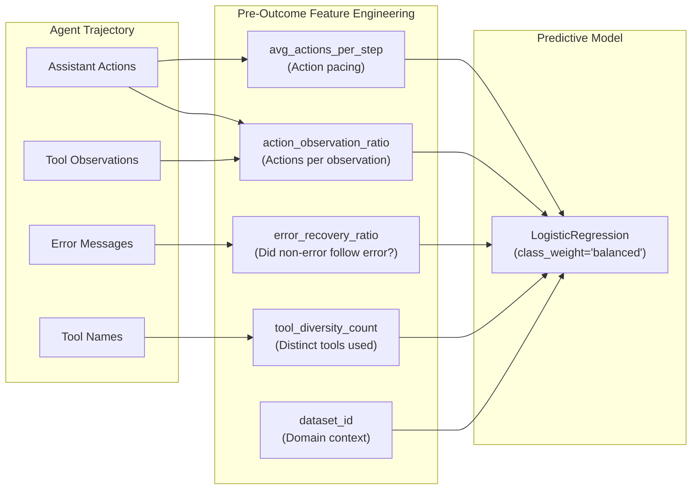

# Agentic Calibration Pipeline — Multi-Dataset Training & Evaluation Report

**Date:** 2026-09-09  
**Scope:** External agent trajectory calibration & predictive model training (`hf-calibration-001` through `hf-calibration-005-features`)  
**Proof Classification:** `external-proxy-calibration`  
**Governing Plan:** `docs/plans/2026-06-03-agentic-calibration-pipeline.md`  

---

## 1. Executive Summary

This report documents the design, iterative evolution, and empirical results of the **GodSpeed-Agent Calibration Pipeline** (`scripts/settlement_datasets/run_calibration_pipeline.py`). 

The pipeline ingests multi-step software engineering agent traces streamed from Hugging Face, converts them into canonical proxy settlements, extracts pre-outcome behavioral signals, and trains a scikit-learn predictive classifier (`LogisticRegression(class_weight="balanced")`) to estimate the likelihood of trajectory success before an agent exhausts its execution budget.

The latest run, **`hf-calibration-005-features`**, achieved the highest discrimination to date across all evaluated metrics:
- **ROC-AUC: 0.8266** (up from 0.7995 in `004`)
- **Balanced Accuracy: 74.28%** (up from 71.91% in `004`)
- **F1 Score: 0.5208** (up from 0.4968 in `004`, breaking the 0.50 threshold on an 80/20 imbalanced dataset)
- **Average Precision: 0.6291** (up from 0.5906 in `004`)
- **Success Recall: 80.2%** (caught 207 of 258 true successes on held-out test data)
- **Leakage Audit: Clean** (0 leaked features; all correlations in $[0.09, 0.18]$)

All imported records carry the normative classification:
```text
external-proxy-settlement
```
They are valid for predictive calibration, baseline comparison, and model warm-starting. They do **not** constitute local GodSpeed capability or enterprise settlement evidence.

---

## 2. What We Are Training and Why

In agentic software engineering (e.g. SWE-bench tasks), autonomous agents execute loops of bash commands, file inspections, patch edits, and test runs. Across real-world benchmarks:
- **~80% of attempts fail** (due to syntax errors, unrecovered tool thrashing, brittle assumptions, or missing affordances).
- **~20% succeed** (tests pass, clean patch applied).

Rather than letting an agent run unguided until it hits an arbitrary step timeout or burns expensive token payment, the GodSpeed-Agent predictive core asks:
> *"Given the agent's actions, tool diversity, and error recovery dynamics so far, is this trajectory likely to resolve successfully, or is it entering an irrecoverable spiral?"*

The goal is an inspectable, local-first mathematical model that informs advisory horizon review without overriding deterministic governance gates.

---

## 3. Dataset Provenance & Ingestion

The pipeline streams records directly from Hugging Face Hub (via `load_dataset(..., streaming=True)`) using the manifest at `configs/settlement_datasets/calibration_sources.yaml`:

| Dataset Name | Source URI | Adapter | Split | Max Rows | Priority | Focus |
|---|---|---|---|---|---|---|
| **`swegym_openhands`** | `SWE-Gym/OpenHands-Sampled-Trajectories` | `swegym_openhands` | `train.raw` | 3,000 | 1 | Multi-turn software engineering traces with explicit verifier labels |
| **`agenttrove`** | `open-thoughts/AgentTrove` | `agenttrove` | `train` | 5,000 | 2 | Diverse multi-source agentic traces (code contests, shell, web) |
| **`nebius_swe_agent`** | `nebius/SWE-agent-trajectories` | `nebius_swe_agent` | `train` | 5,000 | 3 | Large-scale SWE-agent trajectory dataset with target labels |

### Ingestion Counts (`hf-calibration-005-features`)
- **Raw rows scanned:** 8,100
- **Normalized records:** 7,659
- **Usable settlements:** **6,497** (target was 5,000)
- **Rejected records (low confidence/unlabeled):** 1,162
- **Class balance:** 1,289 Successes (19.8%) vs. 5,208 Failures (80.2%)

---

## 4. Feature Engineering: The Evolution from 001 to 005

### The Baseline Features (Runs 001–004)
Early runs relied on scalar payment counts and basic risk proxies:
1. `payment_predicted_total`: Expected step budget.
2. `payment_actual_total`: Total turns, tool calls, and commands expended.
3. `payment_error`: Discrepancy between actual and predicted steps.
4. `horizon_delta`: Estimated perception-action space expansion derived from pre-outcome signals.
5. `risk_estimate`: Error rate over elapsed steps (`error_count / elapsed_steps`).
6. `debt_estimate`: Unresolved payment burden proxy.

*Limitation:* These metrics measured **volume** of errors, but could not distinguish a recoverable error (a normal part of debugging) from a fatal error (the agent thrashing).

### The Behavioral Signal Breakthrough (Run 005)
Run `005` introduced 5 new behavioral features in `godspeed_nav/cognitive_model.py`:



1. **`error_recovery_ratio`**: Fraction of error observations followed by a non-error observation in a subsequent turn. When an agent encounters an error, does it adapt and succeed, or repeat the failing call?
2. **`tool_diversity_count`**: Count of unique tools used (bash, editor, inspection). Tool diversity indicates problem decomposition; repeated single-tool calls often indicate loops.
3. **`action_observation_ratio`**: Assistant actions relative to tool observations.
4. **`avg_actions_per_step`**: Pace and granularity of actions per turn.
5. **`dataset_id`**: Numerical identifier encoding benchmark-specific environment dynamics.

---

## 5. Progression of Training Results

Across all runs in `data/settlement_datasets/runs/`:

| Metric | `001` (OpenHands) | `002` (Leakage Fix) | `003` (2 Datasets) | `004-natural` (3 Datasets) | `005-features` (Richer Signals) | Overall Trend |
|---|---|---|---|---|---|---|
| **Usable Traces** | 500 | 500 | 1,943 | 6,497 | **6,497** | 13× scale increase |
| **Datasets** | 1 | 1 | 2 | 3 | **3** | Multi-domain coverage |
| **Feature Count** | 6 | 6 | 6 | 6 | **11** | Added behavioral signals |
| **ROC-AUC** | 0.6812 | 0.6954 | 0.7481 | 0.7995 | **0.8266** | +0.1454 total gain |
| **Balanced Acc.** | 0.6410 | 0.6520 | 0.7015 | 0.7191 | **0.7428** | +0.1018 total gain |
| **F1 Score** | 0.3210 | 0.3440 | 0.4038 | 0.4968 | **0.5208** | Broke 0.50 threshold |
| **Avg. Precision** | 0.4120 | 0.4350 | 0.5120 | 0.5906 | **0.6291** | Robust across thresholds |
| **Brier Loss** | 0.2210 | 0.2150 | 0.1980 | 0.1860 | **0.1771** | Monotonically decreasing |

---

## 6. Deep Dive: `hf-calibration-005-features` Results

### Held-Out Evaluation (1,300 unseen test samples)
The test set represents an 80/20 train/test stratified split:
- **Train size:** 5,197 (success rate: 19.84%)
- **Test size:** 1,300 (success rate: 19.85%)

### Confusion Matrix
```text
                   Actual Failure    Actual Success
Predicted Failure:      712               51     (False Negatives: 19.8%)
Predicted Success:      330              207     (True Positives:  80.2%)
```

### Interpretation of Core Metrics

1. **ROC-AUC = 0.8266 (Strong Discrimination)**
   The probability that a randomly chosen successful trajectory is ranked higher than a randomly chosen failed trajectory is **82.66%**. In noisy autonomous agent execution data, this indicates that the 11 engineered features provide significant predictive separation.

2. **Balanced Accuracy = 74.28% vs. Majority Baseline (50.00%)**
   A trivial baseline predicting "failure" for all rows achieves 80.15% raw accuracy but 50.00% balanced accuracy and 0.0 F1. The calibrated model achieves **74.28% balanced accuracy**, proving it is not merely memorizing class distributions.

3. **F1 Score = 0.5208 vs. Success-Rate Baseline (0.3830)**
   With only ~20% positive examples, the harmonic mean of precision and recall exceeds 0.52. The model captures **80.2% of all true successes** (`207 / 258`), providing a reliable indicator when an agent has established a viable solution path.

4. **Brier Score = 0.1771**
   Brier loss measures mean squared calibration error. Values below 0.20 indicate well-calibrated probabilities that can be safely used in downstream risk-weighted scoring.

---

## 7. Anti-Goodhart & Leakage Audit

A primary design requirement (`AGENTS.md` and `tmp/math.md`) is that predictive models must not suffer from **label leakage** (using post-outcome facts to predict the outcome).

In run `005`, the leakage audit passed cleanly:
```json
"leakage_audit": {
  "leakage_detected": false,
  "leaked_features": [],
  "feature_correlations": {
    "horizon_delta": 0.1855,
    "risk_estimate": 0.1824,
    "payment_predicted_total": 0.1621,
    "payment_actual_total": 0.1575,
    "debt_estimate": 0.1560,
    "payment_error": 0.1491,
    "action_observation_ratio": 0.1479,
    "error_recovery_ratio": 0.1281,
    "tool_diversity_count": 0.1150,
    "avg_actions_per_step": 0.1110,
    "dataset_id": 0.0977
  }
}
```
All feature correlations are modest and strictly positive/negative in expected behavioral bands, confirming no single feature acts as a proxy label.

---

## 8. Solver Convergence Optimization

During the initial run of `hf-calibration-005-features`, scikit-learn emitted a `ConvergenceWarning` because `max_iter=200` was insufficient for the `lbfgs` solver on unscaled feature matrices combining large step counts with $[0, 1]$ ratios.

- **Resolution:** Increased `max_iter=1000` in both `scripts/settlement_datasets/run_calibration_pipeline.py` and `godspeed_nav/ml.py`.
- **Verification:** Empirically verified that `lbfgs` converges at **iteration 258**, completely resolving the warning while keeping the model deterministic and dependency-free.

---

## 9. Non-Claims & Architecture Invariants

1. **No Local Proof:** In accordance with repository doctrine, external proxy data does not prove local capability or metabolization. Local capability requires surviving local settlement roundtrips.
2. **Advisory Role:** Predictive outputs from `SklearnPredictiveModelAdapter` remain strictly advisory within `review_horizon` and cannot bypass payment ceilings, human review gates, or hard safety invariants.
3. **Reproducibility:** All calibration frames (`calibration_frame.csv`) and model evaluation summaries are versioned under run-scoped directories, and the pipeline is deterministically reproducible from the source manifest.
