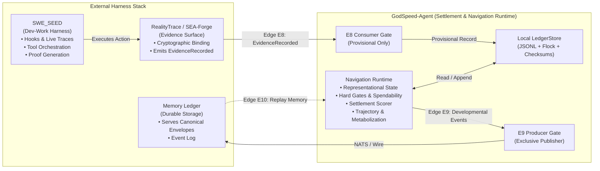
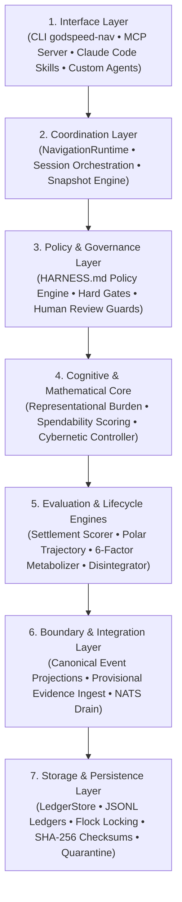
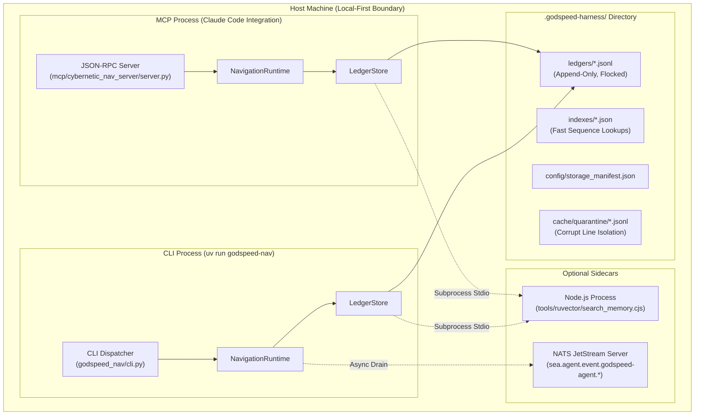

# Architecture Specification

This document defines the canonical architectural model of **GodSpeed-Agent**. It details the logical decomposition, runtime topology, data flow, trust boundaries, and operational invariants governing the system.

---

## 1. System Context & Operational Boundary

GodSpeed-Agent functions as a specialized **settlement and navigation runtime** within a larger cybernetic ecosystem. It maintains a strict ownership boundary with respect to adjacent systems:



### Boundary Contracts
1. **SWE_SEED Boundary**: SWE_SEED is the developer-work harness. It owns tool routing, IDE hooks, live telemetry traces, and proof gating. GodSpeed-Agent registers **no live host hooks** and runs **no trace recorders** (Invariant F-08).
2. **RealityTrace Boundary (Edge E8)**: GodSpeed-Agent is a **provisional-only consumer** of `EvidenceRecorded`. Software proof alone is never settlement. Match/mismatch is preserved as provisional data; settlement requires separate, consequence-evaluated scoring.
3. **Memory Ledger Boundary (Edges E9 & E10)**: GodSpeed-Agent is the **exclusive authoritative producer** of five developmental event types: `SettlementRecorded`, `CapabilityUpdated`, `RepetitionPlanned`, `LearningProposalCreated`, and `CoherenceBreakDetected`. Forge attempts by other components fail closed.

---

## 2. Logical Architecture

GodSpeed-Agent is decomposed into seven distinct logical layers, ordered from highest-level policy to physical persistence:



### Analytical Commentary on Logical Layers
- **Notice**: Gating occurs *before* economic calculations, and economic calculations occur *before* action.
- **Why it matters**: Agents must not expend payment on actions that violate governance or lack validated pathways.
- **What is omitted**: Network polling loops and asynchronous background workers are absent. The core engine is completely synchronous and deterministic; background transports (like NATS event draining) are detached sidecar utilities.

---

## 3. Runtime Topology

GodSpeed-Agent executes locally as an embedded library, standalone CLI, or stdio-based MCP server:



### Process Lifecycles
- **CLI Commands**: Ephemeral, single-command invocations. They initialize `NavigationRuntime`, acquire local file locks on targeted ledgers, append validated events, update indexes, fsync to disk, and terminate with code 0 (or code 2 on `DomainRuleError`).
- **MCP Server**: Long-running JSON-RPC process communicating with Claude Code or another host over `stdio`. Exposes 21 typed cybernetic navigation tools.
- **RuVector Bridge**: Transient Node subprocess invoked on-demand via `subprocess.run` to compute vector embeddings and cosine similarity against indexed memory documents.
- **Settlement Publisher**: Offline-tolerant one-way drain that flushes local event envelopes to NATS JetStream when connectivity exists; silently retains local JSONL authority when offline.

---

## 4. Data Architecture & Persistence Invariants

GodSpeed-Agent relies exclusively on append-only, human-readable JSON Lines (`.jsonl`) files. It enforces enterprise-grade durability through strict physical invariants:

### 1. The Event Envelope Standard
Every formal event record in `payments`, `settlements`, `execution_evidence`, and `developmental_events` is wrapped in a checksummed envelope:
```json
{
  "schema_version": 1,
  "sequence": 42,
  "timestamp": "2026-06-03T18:30:00.000000+00:00",
  "ledger": "settlements",
  "record": { "id": "set-12345", "...": "..." },
  "checksum": "sha256_of_envelope_payload"
}
```

### 2. Concurrency & Atomicity under `flock`
- Writes to any ledger are guarded by OS-level file locking (`fcntl.flock(handle.fileno(), fcntl.LOCK_EX)`).
- Atomicity is preserved by seeking to `SEEK_END`, writing the line, flushing the user-space buffer, and issuing an operating system sync (`os.fsync`).

### 3. Deduplication under Lock
In `append_event_if_absent`, the scan for existing `dedup_field` values and the subsequent append execute within the **same atomic lock context**. Redelivery of identical events produces a zero-consequence dedup hit.

### 4. Zero-Data-Loss Quarantine
If a ledger contains malformed JSON or an envelope whose payload fails SHA-256 checksum verification:
- The corrupted lines are **never** deleted or overwritten.
- Corrupted lines are immediately written to `.godspeed-harness/cache/quarantine/<ledger>.<timestamp>.jsonl`.
- Uncorrupted records continue to be served to the runtime.

---

## 5. Security & Trust Boundaries

```
[Untrusted External Data]
       │
       ▼
┌────────────────────────────────────────────────────────┐
│ Input Sanitization & Secret Redaction                  │
│ • Secrets (api_key, token, password) stripped to '***' │
│ • Ledger names restricted to alnum, '-', '_'           │
└──────────────────────────┬─────────────────────────────┘
                           │
                           ▼
┌────────────────────────────────────────────────────────┐
│ Governance & Policy Gates                              │
│ • Human review mandatory for absorption                │
│ • Human review mandatory for positive disintegration   │
│ • Max payment burden ceiling enforced                  │
└──────────────────────────┬─────────────────────────────┘
                           │
                           ▼
┌────────────────────────────────────────────────────────┐
│ Cryptographic Provenance Gates (Edges E8 / E9)         │
│ • Exclusive producer validation (realitytrace / gsa)   │
│ • Recomputed SHA-256 diff checks (ENV-I10 probe guard) │
│ • Pseudo-hash / placeholder rejection                  │
└────────────────────────────────────────────────────────┘
```

1. **Secret Redaction**: `LedgerStore` scans all incoming records. Keys matching `api_key`, `token`, `password`, `secret`, `authorization`, etc., are replaced with `"[REDACTED]"` before writing to disk.
2. **Path Traversal Guard**: Ledger names are strictly checked against `isalnum()`, `_`, and `-`. Any path containing slashes, backslashes, or `..` raises `StorageError("unsafe_ledger_name")`.
3. **Cryptographic Binding**: In `EvidenceRecorded` ingestion, the claimed `difference.expected_sha256` and `difference.observed_sha256` are recomputed from the payload content. Mismatched digests indicate in-transit tampering and are refused.

---

## 6. Detailed Subsystem Map

For comprehensive implementation details, consult the specialized subsystem guides:

| Subsystem | Primary Module | Core Function |
| :--- | :--- | :--- |
| [Runtime Coordinator](subsystems/runtime-coordinator.md) | `godspeed_nav/runtime.py` | Orchestrates direction, horizon, settlement, and trajectory. |
| [Storage & Ledgers](subsystems/storage-and-ledgers.md) | `godspeed_nav/storage.py` | Manages locked append-only JSONL files, indexes, and quarantine. |
| [Cognitive Computational Core](subsystems/cognitive-computational-core.md) | `godspeed_nav/cognitive_model.py` | Quadratic representational burden, hard gates, spendability. |
| [Developmental Memory](subsystems/developmental-memory-and-events.md) | `godspeed_nav/developmental_memory.py` | Projects and gates the 5 canonical E9 events and E10 retrieval. |
| [Evidence Ingestion](subsystems/evidence-ingestion.md) | `godspeed_nav/evidence_ingest.py` | Enforces fail-closed E8 admission for provisional proof. |
| [Metabolization & Lifecycle](subsystems/metabolization-and-lifecycle.md) | `godspeed_nav/metabolization.py` | 6-factor substrate scoring and variation repetition planning. |
| [Policy & Governance](subsystems/policy-and-governance.md) | `godspeed_nav/policies.py` | Enforces payment limits, opposition jump blocks, and human review. |
| [Agentic Loop Adapters](subsystems/agentic-loop-adapters.md) | `agentic_capability_loop/adapters.py` | Translates internal records to CEP-0008 SS15 v1 wire envelopes. |
| [MCP & CLI Surfaces](subsystems/mcp-and-cli-surfaces.md) | `godspeed_nav/cli.py` | Exposes 21 MCP tools and command-line execution interfaces. |
| [Validation & Observability](subsystems/validation-and-observability.md) | `godspeed_nav/validation.py` | Executes 12 enterprise audits and verifies doctrine drift. |
| [ML & Semantic Search](subsystems/ml-and-semantic-search.md) | `godspeed_nav/ml.py` | Houses dormant sklearn provider and RuVector sidecar bridge. |

---

### Source Trail
- System Specification: `Godspeed_Agent_Harness_SPEC.md`
- Runtime Implementation: `godspeed_nav/runtime.py`
- Storage Implementation: `godspeed_nav/storage.py`
- Policy Specifications: `HARNESS.md`
- Tests: `tests/test_runtime_workflow.py`, `tests/test_enterprise_storage.py`
