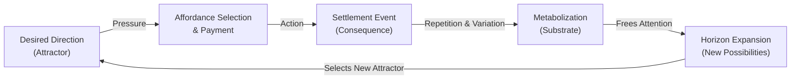
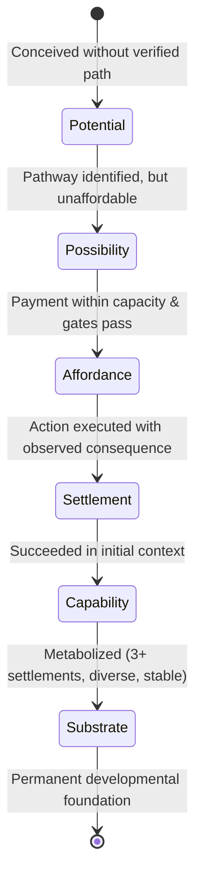

# System Mental Model

This document outlines the conceptual structure and cybernetic principles of **GodSpeed-Agent** without submerging the reader in line-by-line implementation code.

---

## 1. The Core Paradigm: Developmental Cybernetics

Most software systems and AI agent frameworks are **arrival-centric**. They assume:
1. A goal is given.
2. The agent takes actions until the goal is declared satisfied.
3. Execution terminates.

In complex, open-ended environments, arrival-centric design breaks down. Goals are rarely terminal; they are dynamic attractors. Achieving a milestone alters the agent's environment, reveals previously invisible obstacles, and generates new possibilities.

GodSpeed-Agent is built on **developmental cybernetics**:
- **Outcomes are temporary attractors**: An outcome matters because working toward it exerts pressure on the agent to develop capability. Once achieved, the outcome settles, stops exerting pressure, and becomes **substrate**.
- **Horizon expansion is the primary metric**: The true measure of an agent's success is not merely that it crossed an arbitrary finish line, but whether its reachable, spendable perception-action space—its **horizon**—has expanded.
- **Developmental spiral vs circular rotation**: Progress is modeled as a spiral trajectory in polar coordinates $(\theta, r)$. Angular movement $\theta$ represents work expended; radial growth $r$ represents permanent expansion of capability. Work without radial growth is **circular motion** (stagnation).



---

## 2. The Four Stages of Transformation

In GodSpeed-Agent, capabilities do not emerge spontaneously because an agent configured a prompt, called an API, or wrote some lines of code. Capability formation follows four rigorous stages:



### 1. Potential
A transformation that can be described or imagined, but lacks an identified, validated pathway for the observer.
*Example*: "The agent should automatically rewrite the legacy database engine in Rust."
*Operational Rule*: **Potential cannot be scheduled or executed.**

### 2. Possibility
A transformation where a plausible pathway is identified, but required payment exceeds the agent's current capacity (compute, time, risk, or attention).
*Example*: "Run exhaustive fuzz testing across 10,000 edge cases" when the timeout budget is 60 seconds.
*Operational Rule*: **Possibilities are recorded in dormant ledgers until capacity expands.**

### 3. Affordance
A spendable path through state space. An affordance has:
- A concrete, actionable pathway.
- Satisfied preconditions.
- Quantified costs that fall strictly within current capacity.
- Evaluated risk within governance ceilings.
*Operational Rule*: **Only affordances can be executed and settled.**

### 4. Substrate
A capability that has undergone repeated settlement across diverse contexts, exhibited high stability, and ceased to demand conscious monitoring or high attention burden. It becomes the reliable foundation upon which subsequent horizons are perceived.

---

## 3. Representational Space and Path Dependency

Agents do not operate in a vacuum; they inhabit a **representational state**. GodSpeed-Agent projects representational state along two primary axes:
1. **Scope Axis**: From maximally general ($0.0$) to maximally specific ($1.0$).
2. **Mode of Givenness / Embodiment Axis**: From maximally abstract ($0.0$) to maximally concrete ($1.0$).

```
Mode of Givenness (Embodiment)
   ▲
Concrete (1.0) |  Quadrant 4: Specific/Concrete  |  Quadrant 3: General/Concrete
               |  (Unit tests, byte traces)      |  (Working prototype, raw demo)
               |---------------------------------+--------------------------------
Abstract (0.0) |  Quadrant 1: Specific/Abstract  |  Quadrant 2: General/Abstract
               |  (Formal math proof, strict spec)| (Vision manifesto, broad theory)
               +-----------------------------------------------------------------►
             Specific (1.0)                                     General (0.0)
                                      Scope
```

### The Invariant of Opposition Jumps
A novice agent attempts to leap directly across diagonal quadrants—for example, jumping from a broad philosophical idea (General/Abstract) directly to low-level production code (Specific/Concrete).

In cybernetics, direct diagonal jumps have high **continuity risk** and representational burden. GodSpeed-Agent enforces representational path dependency:
- The agent must traverse adjacent representational phases (`general` $\to$ `abstract` $\to$ `specific` $\to$ `concrete`).
- Direct opposition jumps are strictly **blocked** by policy unless the transition has been previously metabolized into an automated shortcut.

---

## 4. Consequence Over Intent

The foundational truth surface of GodSpeed-Agent is **empirical consequence**, not declared intent:
- Self-reported claims ("I completed the task successfully") are treated as empty intent and scored as zero.
- Execution evidence submitted without before/after state diffs is rejected.
- Regressions on existing state keys cancel out superficial gains.
- External proof (e.g. from an automated test runner) is admitted as **provisional evidence** only; it does not constitute settlement until the consequence is verified against the agent's active desired direction.

---

## 5. Positive Disintegration

Inspired by Kazimierz Dąbrowski's theory of positive disintegration, GodSpeed-Agent recognizes that development is not monotonic addition of code.

As an agent evolves:
- Obsolete abstractions, fragile heuristics, and unmaintained legacy structures must undergo **dissolution**.
- Valuable, resilient components must be **salvaged** and absorbed into new substrate.
- Destructive dissolution without salvage is mere damage; addition without dissolution is runaway technical debt.
- Disintegration actions carry strict human-review policy gates to prevent catastrophic self-deletion.

---

## 6. Self-Critique and Falsification

A cybernetic system that cannot critique its own doctrine is brittle. GodSpeed-Agent includes built-in self-critique:
- If settlements succeed but the horizon radius $r$ does not grow, the runtime flags a `dead_end_direction`.
- If angular rotation $\Delta\theta$ accumulates beyond $2\pi$ while radial growth remains negligible ($\le 0.1$), the runtime flags `circular_motion`.
- If an agent treats simulation runs as proof of capability, the runtime flags `simulation_is_not_capability`.

When the framework's own assumptions fail to produce horizon expansion, the framework itself is subject to reconstruction.

---

### Source Trail
- Representational state & transition logic: `godspeed_nav/metrics.py` (`review_representational_transition`)
- Burden calculations: `godspeed_nav/cognitive_model.py` (`compute_representational_burden`)
- Trajectory and circular motion: `godspeed_nav/trajectory.py` (`detect_circular_motion`, `update_trajectory`)
- Metabolization thresholds: `godspeed_nav/metabolization.py` (`compute_metabolization`)
- Doctrine specification: `docs/understanding/2026-05-29-cognitive-operating-systems.md`
