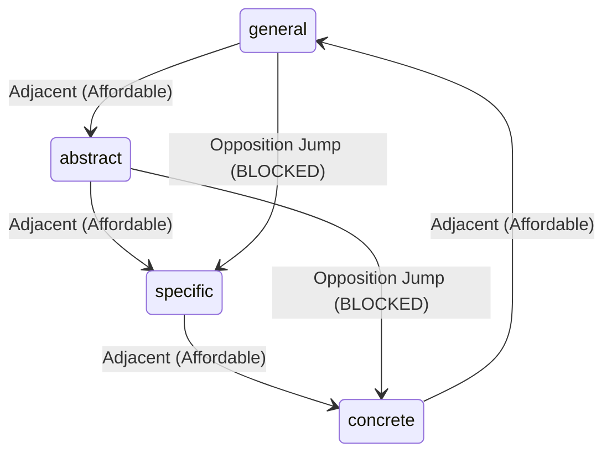

# Explanation: Representational Path Dependency & Opposition Jumps

This document explains why GodSpeed-Agent models **representational space** geometrically and enforces **representational path dependency**.

---

## 1. The Phenomenon of Representational Movement

When humans or AI agents solve problems, they do not merely manipulate physical tools; they shift how they represent the problem:
- Sometimes they work in broad, general abstractions (e.g. designing a software architecture).
- Sometimes they work in narrow, concrete details (e.g. debugging a null-pointer exception at a specific line of code).

These cognitive movements are not casual metaphors; they represent distinct positions in a **representational state space**.

GodSpeed-Agent projects representational state onto two orthogonal axes:
1. **Scope Axis**: From maximally general ($0.0$) to maximally specific ($1.0$).
2. **Mode of Givenness / Embodiment Axis**: From maximally abstract ($0.0$) to maximally concrete ($1.0$).

---

## 2. The Four Representational Quadrants

```
Mode of Givenness (Embodiment)
  ▲
1.0 Concrete | Quadrant 4: Concrete/Specific    | Quadrant 3: Concrete/General
             | Example: Writing unit test assertions | Example: Running a rough end-to-end demo
             | Phase: "concrete"                    | Phase: "concrete"
             |--------------------------------------+-------------------------------------
0.0 Abstract | Quadrant 1: Abstract/Specific    | Quadrant 2: Abstract/General
             | Example: Formal schema definition    | Example: Theoretical vision manifesto
             | Phase: "specific"                    | Phase: "general"
             +────────────────────────────────────────────────────────────────────────────►
            1.0 Specific                                                      0.0 General
                                             Scope
```

---

## 3. Why Opposition Jumps Fail

An **opposition jump** is an attempt to jump directly across the diagonal of representational space:
- **Example A**: Attempting to jump directly from an Abstract/General vision (Quadrant 2) into Concrete/Specific implementation code (Quadrant 4) without creating intermediate schemas or architectural specifications.
- **Example B**: Attempting to jump directly from a raw low-level memory trace (Quadrant 4) to an overarching general theory (Quadrant 2) without intermediate classification.

### The Dynamics of Failure
In cybernetics, direct diagonal transitions suffer from extreme **continuity risk**:
1. **Information Asymmetry**: The jump skips the intermediate state where assumptions, constraints, and interface contracts are negotiated.
2. **Cognitive Overload**: The agent must simultaneously resolve broad conceptual questions and minute syntax/runtime details, leading to hallucinations and high payment burden.
3. **Fragility**: Code written via diagonal jumps lacks coherent modular structure; it works (if at all) only under narrow, brittle conditions.

---

## 4. The Path-Dependency Invariant

GodSpeed-Agent enforces representational path dependency through `review_representational_transition` and `enforce_representational_transition_policy`:



### The Adjacency Rule
- The discrete phase sequence is: `general` $\to$ `abstract` $\to$ `specific` $\to$ `concrete`.
- A transition between adjacent phases is continuous and classified as `"affordable"`.
- A transition spanning two phase gaps (a diagonal jump) is classified as an **opposition jump** and is **hard-blocked by policy**.

---

## 5. Metabolized Shortcuts: The Only Lawful Exception

Can an experienced engineer or a highly trained system ever jump directly from an abstract concept to concrete code? **Yes, but only if the pathway has been metabolized into substrate.**

When a specific transition sequence has settled repeatedly across diverse contexts with low attention burden, it can be registered in `metabolized_shortcuts` (e.g. `"general->specific"`).

- **For an un-metabolized agent**: The opposition jump is blocked; the agent is forced to step through intermediate specifications.
- **For a metabolized agent**: The shortcut is recognized as substrate, and the transition is allowed.

This mechanism mathematically mirrors human cognitive development: novices must follow explicit step-by-step procedures, while masters execute compiled intuition.

---

### Source Trail
- Transition Review: `godspeed_nav/metrics.py` (`review_representational_transition`, lines 212–283)
- Policy Enforcement: `godspeed_nav/policies.py` (`enforce_representational_transition_policy`, lines 72–88)
- Mathematical Burden: `godspeed_nav/cognitive_model.py` (`compute_representational_burden`)
- Verification Suite: `tests/test_computation.py`, `tests/test_policy_gates.py`
