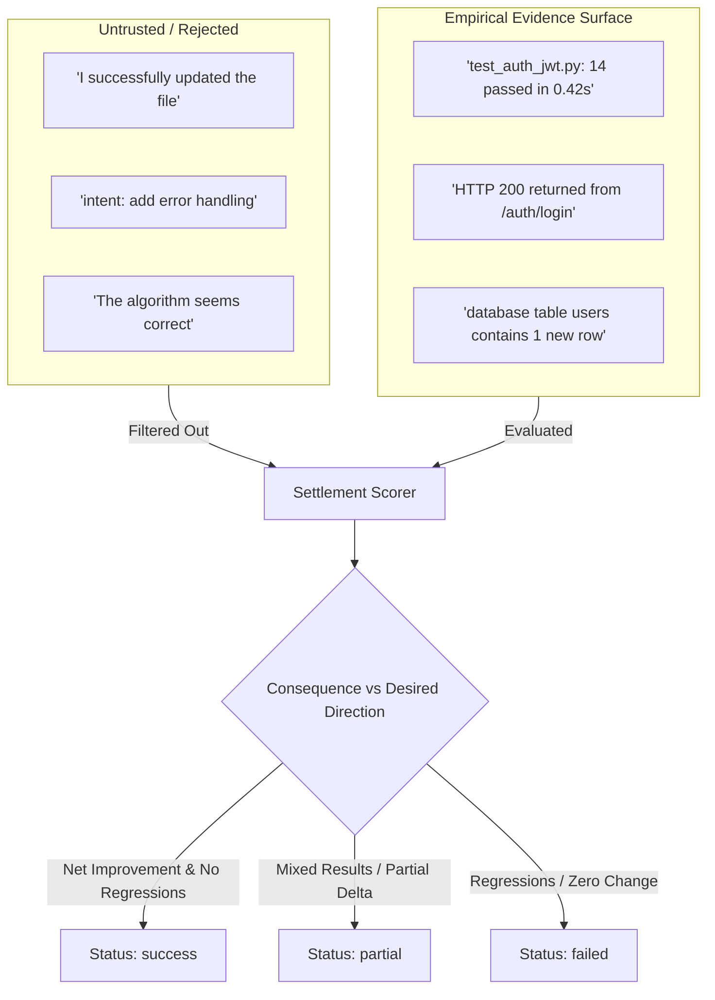

# Explanation: Settlement Versus Intent

This document explains why GodSpeed-Agent rejects declared intent and models **settlement strictly as empirical consequence**.

---

## 1. The Vulnerability of Self-Reported Intent

A ubiquitous weakness of modern AI agent architectures is **self-evaluation bias**:
- An agent is asked: "Did you implement the user login feature?"
- The agent inspects its own generated code, generates a completion summary, and responds: "Yes, I successfully implemented user authentication."
- No external verification occurred; the agent's intent to solve the task was accepted as proof of its accomplishment.

In cybernetics, an agent that evaluates itself solely on internal state and intent is a **broken feedback loop**. It produces uncontrolled drift, hallucinated capability, and silent production failure.

---

## 2. Settlement as Empirical Consequence

GodSpeed-Agent enforces an uncompromising boundary: **Settlement is recorded consequence, not declared intent.**

### What Is Required for Settlement?
To record a settlement via `score_settlement` and `record-settlement`, the system requires:
1. An explicit **before-state** representation: $S_{\text{before}}$.
2. An explicit **after-state** representation: $S_{\text{after}}$.
3. Objective, verifiable **execution evidence** strings.
4. An active **desired direction** establishing criteria.



---

## 3. The Intent-String Rejection Filter

The settlement scoring engine (`godspeed_nav/metrics.py:24-36`) explicitly parses all submitted evidence strings:
- Any evidence entry starting with `"intent:"` (case-insensitive) is automatically classified into `rejected_evidence`.
- If an agent submits *only* intent strings (e.g. `["intent: refactored database", "intent: improved performance"]`), the scorer returns:
  ```json
  {
    "settlement_score": 0.0,
    "status": "failed",
    "evidence_summary": "intent_only",
    "missing_evidence": ["observable_consequence"]
  }
  ```
The settlement fails immediately, regardless of what code was generated.

---

## 4. Why Software Proof Alone Is Provisional (Edge E8)

Even when external automated test runners (such as SWE_SEED or pytest) pass and emit structured `EvidenceRecorded` events, GodSpeed-Agent classifies that data as **provisional**:
- A green unit test proves that a software assertion held in isolation.
- It does **not** prove that the agent's broader desired direction was advanced, that regressions were avoided in un-monitored systems, or that the resulting capability is affordable to maintain.
- External proof is recorded in `canonical_execution_evidence.jsonl`, but it cannot update trajectories or capability lifecycles until an explicit `record-settlement` evaluation is conducted against the active desired direction.

---

## 5. Consequences for Capability Formation

By divorcing settlement from intent:
- Capability records in `capabilities.jsonl` reflect only verifiable, repeatable reality.
- The agent cannot hallucinate its own identity or competence.
- The developmental memory store becomes an immutable audit trail that human engineers and automated supervisors can trust implicitly.

---

### Source Trail
- Evidence Classification: `godspeed_nav/metrics.py` (`_classify_evidence`, lines 24–36)
- Settlement Scoring: `godspeed_nav/metrics.py` (`score_settlement`, lines 122–184)
- Runtime Gate: `godspeed_nav/runtime.py` (`record_settlement`, lines 542–633)
- Provisional Ingestion: `godspeed_nav/evidence_ingest.py` (lines 1–512)
- Contract Tests: `tests/test_computation.py`, `tests/test_runtime_workflow.py`
