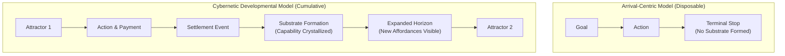

# Explanation: Why Horizon Expansion Over Outcome Completion

This document explains the cybernetic and architectural rationale for establishing **horizon expansion** as the primary system metric rather than static outcome completion.

---

## 1. The Fallacy of Arrival-Centric Design

Most artificial intelligence frameworks are arrival-centric:
1. The operator assigns an outcome $O$.
2. The agent executes steps $a_1, a_2, \dots, a_n$ until an evaluation function declares $O$ reached.
3. The process terminates.

While this paradigm succeeds in closed, static domains (like chess or simple calculator scripts), it consistently breaks down in open-ended software engineering and cybernetic systems.

### Failure Modes of Arrival-Centricity
- **Goodhart's Law & Premature Halting**: When goal achievement is the sole terminal objective, agents optimize for the narrowest, most fragile path to trigger the completion signal (e.g. mocking a test instead of fixing a bug).
- **Substrate Neglect**: Arrival-centric agents treat work as disposable scaffolding. Once the finish line is crossed, no effort is spent turning that solution into reusable, low-burden substrate. The next task starts from zero.
- **Inability to Adapt to Emerging Pressure**: In real development, achieving step 1 changes the environment, rendering the original formulation of step 2 obsolete. Arrival-centric agents blindly pursue the original goal even when empirical conditions have shifted.

---

## 2. Cybernetic Attractors vs. Terminal Gods

In GodSpeed-Agent, outcomes matter, but they are not terminal endpoints:
- An outcome is treated as a **temporary attractor**.
- The value of an attractor is that it exerts **developmental pressure** on the agent.
- That pressure forces the agent to identify missing pathways, spend payment, confront environmental errors, and form new capabilities.

Once an outcome is settled, its pressure drops to zero. Its permanent contribution is that it settles into **substrate**—reliable, automated foundation that frees cognitive capacity to perceive a wider horizon.

---

## 3. Horizon as Perception-Action Space

The term **horizon** is drawn from phenomenology and cybernetics:
- It represents the boundary of what an observer can currently perceive, afford, and spend.
- Horizon is not merely "what data is on disk" or "what tools are in PATH".
- An agent may have access to a tool (affordance inventory) but lack the stability, knowledge, or error-handling to spend it without failure (affordance utilization).

Horizon expansion means:
1. Transformations that were previously **potentials** (lacking pathways) now have concrete, validated routes.
2. Transformations that were previously **possibilities** (unaffordable) are now within capacity because earlier capabilities reduced payment burden.
3. Attention burden required to execute routine tasks decays toward zero.

---

## 4. Why This Protects Maintainability

Optimizing for horizon expansion ensures that agent systems generate durable engineering equity:
- Agents build and test reusable libraries, schemas, and adapters rather than generating monolithic single-file spaghetti scripts.
- Every development cycle leaves behind verified developmental memory and tested capabilities.
- The system naturally resists circular motion and trivial busywork.

---

### Source Trail
- Doctrine Manifesto: `Cognitive Operating Systems (1).pdf`
- Framework Doctrine: `docs/understanding/2026-05-29-cognitive-operating-systems.md`
- Configuration Contract: `HARNESS.md` (`primary_metric: horizon_expansion`, `outcome_as_terminal: false`)
