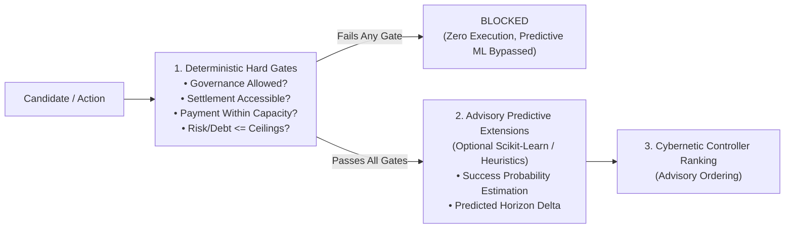

# Explanation: Why Local-First and Deterministic

This document explains why GodSpeed-Agent enforces a **local-first** storage architecture and mandates **deterministic accounting before predictive machine learning**.

---

## 1. The Trap of "Imaginary Muscles"

When AI agents are integrated into software engineering workflows, a common trap emerges: **simulated competence**.
- A large language model or predictive neural network generates plausible-sounding explanations of how a capability works.
- The agent or operator mistakes the model's fluent output for actual, metabolized execution competence.
- When exposed to unpredicted production failure modes, the system collapses because the capability was never grounded in empirical settlement.

In the GodSpeed-Agent doctrine, this phenomenon is called **imaginary muscles**. To prevent simulated competence from contaminating the developmental record:
1. **Explanation is not capability**: Describing a pathway does not make it an affordance.
2. **Access is not capability**: Having an API key or an installed library does not mean the agent can utilize it effectively.
3. **Simulation is not settlement**: A dry-run in an idealized simulator cannot replace empirical consequence in the target environment.

---

## 2. Deterministic Before Predictive

In GodSpeed-Agent, mathematical accounting and rule-based policy gates **always** run before predictive ML:

### Why Deterministic Gating Must Come First
- **Explainability**: If an action is blocked, the system returns an exact, typed reason (e.g. `payment_capacity_exceeded`). The operator never has to reverse-engineer an opaque neural network weight to understand why a candidate was rejected.
- **Fail-Closed Safety**: A machine learning model predicting a 99% success probability cannot override an exhausted compute budget or an unvetted license.
- **Dormancy Until Proof Exists**: The built-in scikit-learn adapter remains strictly dormant until at least 200 empirical settlement events have been recorded in the local ledgers. You cannot train a predictor on zero ground truth.

---

## 3. The Local-First Architecture

GodSpeed-Agent relies exclusively on local files (`.godspeed-harness/`), local JSONL ledgers, local Node.js sidecars, and standard OS facilities (`flock`). It introduces **zero mandatory external cloud dependencies**.

### Architectural Rationale for Local-First
1. **Sovereignty & Privacy**: Developmental memory records an organization's raw engineering history—including bugs, failed attempts, and architecture experiments. This developmental memory must never be forced into third-party cloud analytics or external telemetry services by default.
2. **Network Partition Resilience**: An agent working in an air-gapped environment, on an airplane, or during a cloud outage must retain 100% of its navigation, gating, and settlement capabilities.
3. **Zero-Configuration Onboarding**: Contributors do not need to configure AWS credentials, provision PostgreSQL databases, or register for SaaS API keys to start using the runtime. A local Python environment and a filesystem are all that is required.
4. **Append-Only Immutability**: Operating system file locking (`flock`) on local append-only JSONL files provides bulletproof concurrency for local single-node agent execution without the operational overhead of a distributed database cluster.

---

### Source Trail
- System Policy: `HARNESS.md` (`computation.model_provider: heuristic`, `computation.ml_event_threshold: 200`)
- Architectural Boundary: `README.md` ("Deterministic before predictive")
- Implementation: `godspeed_nav/cognitive_model.py`, `godspeed_nav/ml.py`
