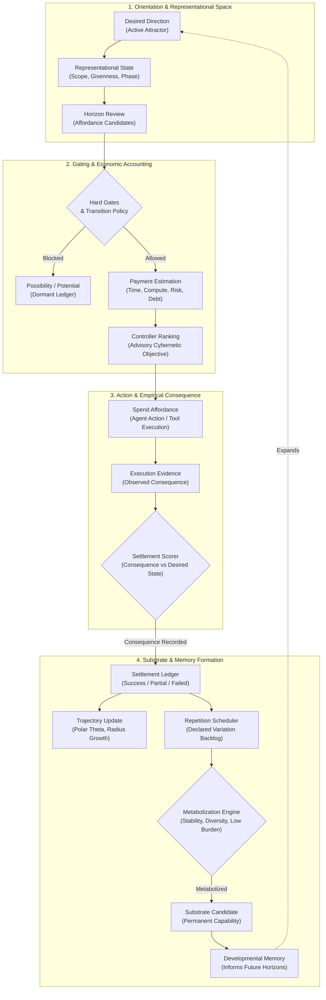

# GodSpeed-Agent Documentation Hub

Welcome to the **GodSpeed-Agent** technical documentation system. GodSpeed-Agent is a local-first cybernetic settlement and navigation runtime for AI agents.

This documentation serves two audiences simultaneously:
1. **Newcomers**: Seeking an intuitive mental model, clear vocabulary, and rapid onboarding without wading through deep source code.
2. **Engineers & Architects**: Demanding mathematical precision, execution lifecycles, state ownership rules, failure boundaries, and exact source traceability.

---

## 1. What This Project Is

GodSpeed-Agent is a local-first Python runtime and Claude Code plugin that operationalizes **horizon-centric cybernetic development**. Instead of treating an agent as a one-shot task executor that stops when a declared goal is reached, GodSpeed-Agent treats outcomes as temporary attractors that settle into reusable **substrate**. It converts desired directions into empirical horizon reviews, affordance selection, payment accounting, consequence-based settlement, repetition planning, metabolization, and developmental memory.

### The Problem It Solves

Standard AI agent loops suffer from fundamental architectural failure modes:
- **Arrival-Centricity & Stagnation**: Once an agent declares a goal "done", execution halts. The system does not harvest developmental memory or determine what new capabilities or affordances were unlocked.
- **Imaginary Muscles (Confusing Possibility with Affordance)**: Agents hallucinate that an action is directly executable simply because it can be articulated, ignoring missing dependencies, prohibitive payment costs, or lack of validated pathways.
- **Intent-as-Settlement**: Agents report success based on self-reported intent or unverified model output rather than observable consequence in the environment.
- **Opposition Jumps**: Agents attempt violent representational leaps (e.g. from abstract theory straight into concrete implementation) without traversing intermediate states, leading to high cognitive burden and brittle failure.
- **Ephemeral Amnesia**: Prior successes and failures vanish between sessions, preventing true capability metabolization.

GodSpeed-Agent replaces ungrounded agent execution with an empirical, deterministic cybernetic control loop.

---

## 2. The System in One Picture

The diagram below illustrates the canonical developmental loop executed by GodSpeed-Agent:

---

## 3. The 10 Core Concepts You Need First

1. **Desired Direction**: The active attractor (goal, problem, vision, outcome). It is never a terminal destination; when settled, it becomes substrate.
2. **Horizon**: The boundary of what is currently perceivable and spendable by the observer based on active capabilities and substrate.
3. **Representational State**: The observer's current position in scope (general $\leftrightarrow$ specific) and mode of givenness / embodiment (abstract $\leftrightarrow$ concrete).
4. **Affordance**: A spendable path through state space. It requires an active pathway, required preconditions, and affordable payment.
5. **Potential vs Possibility**: A *potential* lacks a validated pathway. A *possibility* has a pathway but exceeds current payment capacity. Neither can be spent.
6. **Payment**: The real cost required to execute an affordance across multiple resource dimensions (time, compute, risk, debt, coordination).
7. **Settlement**: The empirical consequence recorded by reality or the evidence surface. Settlement is evaluated strictly on observed before/after consequence, never declared intent.
8. **Trajectory**: The developmental spiral path measured in polar coordinates $(\theta, r)$. Radial growth indicates genuine horizon expansion; pure angular rotation indicates circular motion (stagnation).
9. **Metabolization**: The stabilization of capability into effortless substrate through repeated settlement ($\ge 3$), context diversity ($\ge 2$), high stability ($\ge 0.8$), and low attention/maintenance burden ($\le 0.3$).
10. **Substrate**: Metabolized capability that operates reliably in the background, freeing cognitive capacity to perceive further horizons.

---

## 4. A Representative Journey

Here is how a real task flows through the GodSpeed-Agent runtime:

1. **Direction Initiated**: An operator or agent launches a desired direction (`godspeed-nav start-direction`). The system assigns a unique direction ID and initial horizon.
2. **Representational Check**: The observer registers its representational state (`godspeed-nav set-representational-state`) in scope and givenness.
3. **Horizon Review**: The agent submits candidate pathways. The runtime runs hard gates (governance, payment capacity, risk/debt ceilings). Unviable paths are segregated into `potentials` or `possibilities`. Valid candidates are stored in `affordances` and ranked by spendability and controller objective (`godspeed-nav review-horizon`).
4. **Action & Consequence**: The agent executes the top-ranked affordance. An external runner or test suite yields observable before/after state and evidence logs.
5. **Settlement Evaluated**: The runtime scores the settlement (`godspeed-nav record-settlement`). Intent strings (`"intent:..."`) are rejected. If regressions exist, success is withheld. Consequence is committed to the append-only ledger.
6. **Trajectory & Repetition**: The runtime calculates radial expansion $\Delta r$ and angular advance $\Delta\theta$. If the capability is not yet metabolized, a repetition plan under variation is scheduled.
7. **Substrate Formed**: After 3 diverse, stable settlements, the capability transitions to `substrate_candidate`, expanding the horizon for subsequent cycles.

---

## 5. Navigation by Reader Intent

Where should you go next?

### "I want to get it running quickly"
- [Getting Started Guide](getting-started.md): Installation options (CLI, Docker, development) and running your first command.
- [First Developmental Loop Tutorial](tutorials/first-developmental-loop.md): Step-by-step hands-on walkthrough running the core cycle from the terminal.

### "I want to understand the conceptual foundation"
- [System Mental Model](concepts/mental-model.md): Deep dive into cybernetics, horizon expansion, and attractor dynamics.
- [Vocabulary & Taxonomy](concepts/vocabulary.md): Complete domain glossary with normative definitions.
- [Why Horizon Over Outcomes](explanations/why-horizon-over-outcomes.md): Theoretical rationale against arrival-centric agent architectures.
- [Representational Path Dependency](explanations/representational-path-dependency.md): Why opposition jumps fail and how burden is calculated.

### "I want to inspect the architecture and subsystems"
- [Architecture Overview](architecture.md): Canonical architecture, logical layers, runtime topology, and security boundaries.
- [Subsystem Guides](subsystems/runtime-coordinator.md): Modular decomposition of all 11 core subsystems.
- [Execution Workflows](workflows/core-developmental-cycle.md): Detailed end-to-end execution paths with sequence tables.

### "I need exact API, schema, or configuration details"
- [CLI Reference](references/cli-reference.md): Every command, flag, input signature, and JSON output format.
- [Ledger Reference](references/ledger-reference.md): Schema and layout of all JSONL ledgers.
- [Policy Reference](references/policy-reference.md): Configuration settings in `HARNESS.md` and their enforcement points.
- [Schema Index](references/schema-index.md): JSON schema catalog.

### "I am debugging an operational failure or building an extension"
- [Troubleshooting Common Failures](how-to/troubleshoot-common-failures.md): Resolving blocked transitions, unaffordable candidates, and circular motion.
- [Add a Custom Predictive Provider](how-to/add-a-custom-predictive-provider.md): Implementing the `PredictiveModelPort` interface.
- [Enterprise Validation Guide](how-to/run-enterprise-validation.md): Running the full enterprise audit suite.

### "I want to trace concepts back to implementation code"
- [Source Map](source-map.md): Symbol-level mapping linking every architectural concept to exact Python files, functions, and tests.
- [Documentation Map](documentation-map.md): Master meta-index classifying all documentation pages by Diátaxis quadrant.

---

### Source Trail
- Implementation entrypoint: `godspeed_nav/cli.py`
- Core runtime: `godspeed_nav/runtime.py`
- Configuration defaults: `HARNESS.md`
- Specification: `Godspeed_Agent_Harness_SPEC.md`
