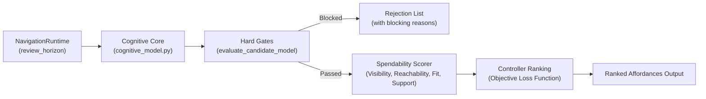

# Subsystem: Cognitive Computational Core

The **Cognitive Computational Core** implements the deterministic mathematical foundation of GodSpeed-Agent. It translates cybernetic control theory and representational geometry into measurable, computable instruments.

---

## 1. Purpose

The subsystem eliminates ungrounded heuristic guessing in agent decision-making. It provides deterministic algorithms to measure representational burden, enforce hard safety and governance gates, calculate continuous affordance spendability, and rank candidate pathways via a cybernetic loss objective.

---

## 2. Responsibilities

- **Representational Burden Metric**: Computes the cognitive distance and over-specification penalty between representational states using a strictly positive-definite quadratic form.
- **Hard Gate Evaluation**: Enforces non-negotiable checks (governance clearance, settlement access, payment capacity, and context-dependent risk/debt ceilings).
- **Spendability Scoring**: Evaluates continuous affordance viability as a weighted combination of visibility, reachability, payment fit, and capability support.
- **Cybernetic Controller Ranking**: Computes an advisory objective loss function to order approved candidates.
- **Calibration Frame Extraction**: Transforms settled records into structured Pandas DataFrames for downstream model calibration and audit.

---

## 3. Non-Responsibilities

- **State Persistence**: Does not persist candidates or evaluations to disk; operates as pure functional computation.
- **Predictive Machine Learning**: Does not train models or run neural networks; provides input data frames for optional external ML adapters.

---

## 4. Position in the System

- **Callers**: `NavigationRuntime.review_horizon`, `NavigationRuntime.rank_candidates_with_memory`, and the `rank-affordances` CLI command.
- **Callees**: NumPy and Pandas.

---

## 5. Core Abstractions & Parameters

### RepresentationalCoordinates
Position in the two-axis continuous projection:
- `scope`: Continuous scalar in $[0.0, 1.0]$ ($0.0 = \text{general}, 1.0 = \text{specific}$).
- `givenness`: Continuous scalar in $[0.0, 1.0]$ ($0.0 = \text{abstract}, 1.0 = \text{concrete}$).

### BurdenParameters
Weights for the representational burden quadratic form:
- $w_{\text{scope}} = 1.0$, $w_{\text{givenness}} = 1.0$, $w_{\text{interaction}} = 0.0$
- $\text{matrix\_floor } (\delta) = 0.05$ (ensures strict positive-definiteness)
- $\text{overflow\_weight} = 0.25$ (penalizes over-specification beyond threshold)

### Context Ceilings (`RISK_CEILINGS`, `DEBT_CEILINGS`)
Hard limits that scale by operational context:
| Context | Max Risk Ceiling | Max Debt Ceiling |
| :--- | :--- | :--- |
| `exploration` | $0.50$ | $0.50$ |
| `production` | $0.30$ | $0.30$ |
| `recovery` | $0.20$ | $0.15$ |
| `safety_critical` | $0.05$ | $0.05$ |

---

## 6. Mathematical Formulations

### 1. Representational Burden
Given current state $R_{\text{curr}}$ and target state $R_{\text{targ}}$, let $\Delta R = R_{\text{targ}} - R_{\text{curr}}$.
The floored burden matrix $M_{\delta}$ is:
$$M_{\delta} = \begin{bmatrix} w_{\text{scope}} & w_{\text{interaction}} \\ w_{\text{interaction}} & w_{\text{givenness}} \end{bmatrix} + \delta I$$

The raw burden is:
$$\text{burden}_{\text{raw}} = \sqrt{\Delta R^T M_{\delta} \Delta R}$$

Accounting for distinction overflow:
$$\text{scope\_overflow} = \max\left(0.0, \frac{\text{distinctions}_{\text{current}}}{\text{distinctions}_{\text{max}}} - 1.0\right)$$
$$\text{burden} = \text{burden}_{\text{raw}} + (\text{overflow\_weight} \times \text{scope\_overflow})$$

### 2. Continuous Spendability ($S$)
For candidates that pass all hard gates, spendability is scored across four weighted factors:
$$S = w_V V + w_R R + w_F F + w_C C$$
Where weights are:
- $w_V = 0.20$ (Visibility: pathway and settlement described)
- $w_R = 0.25$ (Reachability: fraction of satisfied preconditions)
- $w_F = 0.35$ (Payment Fit: most constrained currency binding ratio)
- $w_C = 0.20$ (Capability Support: fraction of required capabilities active)

Payment fit uses the conservative minimum rule across all resource dimensions:
$$F = \min_{i} \left[ \text{clamp}\left(1.0 - \frac{\text{required}_i}{\text{capacity}_i}, 0.0, 1.0\right) \right]$$

### 3. Cybernetic Controller Objective
Surviving candidates are ranked by an advisory loss objective $J$ (lower ranks higher):
$$J = \text{error\_cost} + \lambda \cdot \text{burden} + \mu \cdot \text{risk} + \nu \cdot \text{debt} - \eta \cdot \text{horizon\_gain} - \kappa \cdot \text{direction\_score}$$

Default Controller Weights:
- $\lambda = 0.5$ (Burden weight)
- $\mu = 1.5$ (Risk penalty)
- $\nu = 0.8$ (Debt penalty)
- $\eta = 0.3$ (Horizon expansion incentive)
- $\kappa = 0.5$ (Direction alignment incentive)

---

## 7. Failure Modes & Blocking Reasons

When `evaluate_candidate_model` blocks a candidate, `allowed` is returned as `False` with one or more explicit typed strings:
- `governance_blocked`: Candidate marked `governance_allowed: False`.
- `settlement_inaccessible`: Candidate lacks a verifiable consequence verification surface.
- `payment_capacity_exceeded`: Required payment on at least one currency exceeds current capacity.
- `risk_ceiling_exceeded`: Estimated risk exceeds the context-specific ceiling.
- `debt_ceiling_exceeded`: Estimated technical debt exceeds the context-specific ceiling.

---

## 8. Extension Points

- **Context-Specific Weight Tuning**: Operators can pass custom context parameters (`exploration`, `safety_critical`) or override `CONTROLLER_WEIGHTS` via runtime policy.
- **Pre-Outcome Feature Engineering**: `build_calibration_frame` can be extended with rich behavioral signals (tool diversity, error recovery ratio, action/observation ratios) to support predictive models.

---

### Source Trail
- Subsystem File: `godspeed_nav/cognitive_model.py`
- Key Functions:
  - `compute_representational_burden`: `cognitive_model.py:86-125`
  - `evaluate_candidate_model`: `cognitive_model.py:219-272`
  - `rank_candidates_by_controller`: `cognitive_model.py:288-359`
  - `build_calibration_frame`: `cognitive_model.py:375-440`
- Theoretical Foundation: `docs/understanding/2026-05-29-cognitive-operating-systems.md`
- Verification Tests: `tests/test_computation.py`
