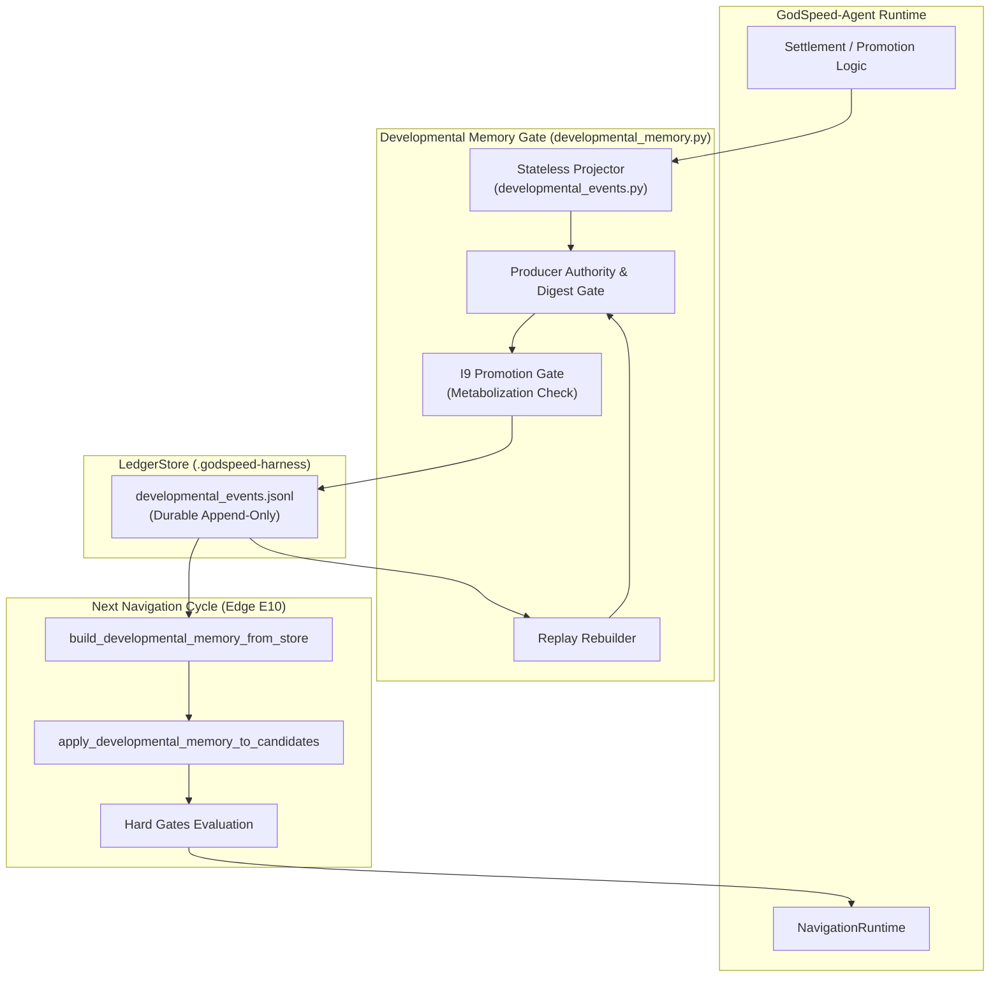

# Subsystem: Developmental Memory & Events

The **Developmental Memory & Events** subsystem governs the durable write seam (Edge E9) and retrieval seam (Edge E10) between GodSpeed-Agent and the broader memory ecosystem. It projects, gates, and replays canonical developmental events.

---

## 1. Purpose

The subsystem ensures that developmental history reflects earned capability rather than inflated claims. It enforces strict provenance, exclusive producer authority, structural cryptographic hashes, and causal lineage before any developmental milestone enters durable memory.

---

## 2. Responsibilities

- **Exclusive Producer Authority (Edge E9)**: Asserts that all five developmental event types originate exclusively from `godspeed_agent`. Forge attempts from external components fail closed.
- **Canonical Event Projection**: Projects runtime decisions into standard `v1` envelopes shared across the architecture:
  1. `SettlementRecorded`
  2. `CapabilityUpdated`
  3. `RepetitionPlanned`
  4. `LearningProposalCreated`
  5. `CoherenceBreakDetected`
- **Promotion Gating (Invariant I9)**: Enforces that `CapabilityUpdated` requests targeting `metabolized` status can only be admitted if historical settlement evidence genuinely satisfies stability, diversity, and burden decay thresholds.
- **Durable Replay Semantics**: Rebuilds gate state on process startup by replaying the durable ledger through the exact same admission gate.
- **Memory-Informed Navigation (Edge E10 / Invariant I12)**: Projects durable history into a canonical `DevelopmentalMemory` envelope and injects candidate boosts into horizon reviews *before* hard gates are evaluated.

---

## 3. Non-Responsibilities

- **Physical File IO**: Delegates appending and locking to `LedgerStore`.
- **Wire Transport**: Does not maintain direct network connections; delegating event broadcast to `SettlementPublisher` (NATS drain).

---

## 4. Position in the System

---

## 5. Core Invariants & Fail-Closed Rules

### 1. Exclusive Producer Authority
Only `godspeed_agent` is permitted to author the five developmental event types. Envelopes claiming other producers (e.g. `swe_seed`, `sea_forge`, `realitytrace`) are rejected immediately.

### 2. Identity & Digest Verification
- Envelopes must specify a canonical 64-character lowercase SHA-256 digest.
- The fallback pseudo-hash (`sha256("agentic_capability_loop")`) and all-zero hashes (`000...000`) are explicitly rejected as untrusted placeholders.

### 3. Causality & Provenance (Causal Invariant)
Every developmental event must cite at least one well-formed `caused_by:` parent event ID representing the underlying evidence or provisional event that triggered it.

### 4. Invariant I9: Earned Capability Promotion Gate
When an envelope requests promotion of a capability to `metabolized`, the gate inspects the capability's actual settlement history in durable storage:
- Minimum 3 successful settlements.
- Context diversity $\ge 2$ recorded on the settlements themselves.
- Average stability score $\ge 0.8$.
- Inline claims of variation in the promotion request are ignored; variation must be verifiable in prior recorded settlement evidence.

### 5. Invariant I14 / I15: Durable Idempotency
- Redelivery of an identical envelope with the same `event_id` and payload is a consequence-free no-op.
- Submission of a mutated payload under an existing `event_id` is refused by name, and the original record stands.

---

## 6. The Gate-Evaluation-After-Memory Pattern (Edge E10)

When historical developmental memory is retrieved to inform a new horizon review:
1. **Retrieval**: `get_developmental_memory()` projects verified historical settlements into a `DevelopmentalMemory` envelope.
2. **Evidence Boost**: Candidates that echo historical capabilities receive a search burden discount (a boost to `expected_horizon_delta` and `direction_score`).
3. **Hard Gate Evaluation**: Every candidate—boosted or not—must pass `evaluate_candidate_model` (governance, settlement accessibility, payment capacity, risk/debt ceilings).
4. **Invariant I12**: Memory is evidence, **not** an override. Memory can never flip a blocked gate to allowed.

---

## 7. Failure Modes

| Refusal Code | Root Cause | Mitigation |
| :--- | :--- | :--- |
| `unauthorized_producer` | Envelope author was not `godspeed_agent`. | Only GodSpeed-Agent may project developmental events. |
| `placeholder_domain_model_hash` | Envelope carried the fallback pseudo-hash or zero-hash. | Compute and supply the true structural SHA-256 digest of the manifest. |
| `missing_caused_by_parent` | Provenance chain lacks parent evidence references. | Attach the justifying provisional evidence ID in `parent_evidence_ids`. |
| `unearned_promotion_refusal` | Requested promotion to `metabolized` without meeting the 3-settlement diversity/stability bar. | Execute further settlements under declared variation before requesting promotion. |
| `mutated_redelivery` | Same `event_id` resubmitted with conflicting payload fields. | Generate a new UUID for distinct developmental decisions. |

---

### Source Trail
- Gate Definition: `godspeed_nav/developmental_memory.py` (lines 1–1208)
- Projection Logic: `godspeed_nav/developmental_events.py` (lines 1–279)
- Key Symbols:
  - `project_developmental_event`: `developmental_events.py:102-180`
  - `persist_developmental_event`: `developmental_memory.py:240-340`
  - `build_developmental_memory_from_store`: `developmental_memory.py:450-520`
  - `apply_developmental_memory_to_candidates`: `developmental_memory.py:610-675`
- Verification Tests: `tests/test_convergence_t09_developmental_memory.py`, `tests/test_convergence_t10_developmental_memory_feedback.py`
