# Subsystem: Evidence Ingestion

The **Evidence Ingestion** subsystem implements the fail-closed Edge E8 admission gate. It consumes external execution evidence (`EvidenceRecorded`) generated by test runners or external agents (e.g., RealityTrace, SWE_SEED) and stores it strictly as provisional data.

---

## 1. Purpose

The subsystem guarantees that external execution assertions do not bypass consequence-based settlement. It enforces cryptographic verification, producer checks, and provenance binding on all incoming proof data while upholding the non-negotiable invariant: **Software proof alone is never settlement.**

---

## 2. Responsibilities

- **Stateless E8 Admission Gating**: Validates inbound `EvidenceRecorded` envelopes against all frozen schema constraints.
- **Exclusive E8 Producer Check**: Enforces that only `realitytrace` may stamp `EvidenceRecorded`. Forge attempts by other agents fail closed.
- **Cryptographic Difference Binding**: Recomputes SHA-256 digests over expected and observed outcomes to detect in-transit tampering or stale probe data (Invariant ENV-I10).
- **Provisional Classification**: Persists admitted evidence as inert, provisional data in `canonical_execution_evidence.jsonl`.
- **Deduplication & Replay Idempotency**: Guarantees that redeliveries of identical evidence produce zero state modifications, while conflicting resubmissions under the same cycle ID are refused.

---

## 3. Non-Responsibilities

- **Settlement Evaluation**: Does not evaluate whether an affordance succeeded, partialed, or failed.
- **Capability Promotion**: Has zero authority or code paths to modify capability status, update trajectories, or schedule repetitions (Invariant I8).
- **Test Execution**: Does not execute tests or monitor processes; it only ingests recorded proof facts.

---

## 4. Position in the System

```mermaid
flowchart LR
    RT["RealityTrace / SEA-Forge\n(Edge E8 Producer)"] -->|EvidenceRecorded Envelope| GATE["ingest_evidence_recorded\n(evidence_ingest.py)"]

    subgraph Checks ["Fail-Closed Admission Checks"]
        PROD["Producer == 'realitytrace'"]
        REQ["All 9 Required Fields Present"]
        HASH["Crypto Difference Hashes Recomputed"]
        CAUS["Causality & Parent Validation"]
        DEDUP["Idempotency / Claim Stability Check"]
    end

    GATE --> Checks
    Checks -- Passed --> PROV["ProvisionalEvidence\n(Inert Value Object)"]
    Checks -- Failed --> REF["Refusal (DomainRuleError)"]

    PROV --> STORE["LedgerStore.append_event_if_absent\n(canonical_execution_evidence.jsonl)"]

    subgraph Firewalled ["Explicitly Firewalled (Invariant I8)"]
        SETT["settlements.jsonl"]
        CAPS["capabilities.jsonl"]
        TRAJ["trajectories.jsonl"]
    end

    PROV -.->|CANNOT WRITE| Firewalled
```



---

## 5. Core Abstractions

- `ingest_evidence_recorded`: Pure, stateless admission function returning an `EvidenceAdmission` result.
- `EvidenceAdmission`: Status container (`"admitted"`, `"duplicate"`, or `"refused"`) with error message or parsed `ProvisionalEvidence`.
- `ProvisionalEvidence`: Immutable value object representing verified execution proof. Contains no promotion or settlement methods.
- `EvidenceIngestState`: In-memory deduplication cache tracking seen event IDs and claim tuples `(work_request_id, proof_result_ref)`.

---

## 6. The 9 Required Fields

Inbound `EvidenceRecorded` envelopes must supply all nine fields simultaneously; partial or empty values trigger immediate refusal:
1. `event_id`: UUID or Crockford Base32 identifier.
2. `work_request_id`: Active task / cycle reference.
3. `affordance_id`: Persisted executable affordance ID.
4. `expected_outcome`: Declared target state / assertion.
5. `observed_outcome`: Empirical observation from execution.
6. `difference`: Object containing `difference.expected_sha256` and `difference.observed_sha256`.
7. `proof_result_ref`: Link to the concrete test / tool result.
8. `operational_settlement_ref`: Correlation link to the operational cycle.
9. `domain_model_ref`: Manifest reference matching the active model SHA-256.

---

## 7. Cryptographic Difference Re-Computation (ENV-I10)

To prevent attackers or compromised agents from submitting a stale diff over a mutated payload, the admission gate independently recomputes the outcome hashes:
```python
computed_expected = hashlib.sha256(json.dumps(payload["expected_outcome"], sort_keys=True).encode("utf-8")).hexdigest()
computed_observed = hashlib.sha256(json.dumps(payload["observed_outcome"], sort_keys=True).encode("utf-8")).hexdigest()

if (computed_expected != difference["expected_sha256"] or
    computed_observed != difference["observed_sha256"]):
    raise DomainRuleError("cryptographic_difference_mismatch", "Difference hashes do not match payload outcomes.")
```

---

## 8. Failure Modes & Refusals

| Refusal Code | Cause | Invariant Protected |
| :--- | :--- | :--- |
| `forged_evidence_producer` | Event authored by an identity other than `realitytrace`. | Exclusive E8 Producer Authority. |
| `incomplete_execution_evidence` | One or more of the 9 required fields is missing or empty. | Complete Evidence Boundary. |
| `cryptographic_difference_mismatch` | `difference.*_sha256` does not match the hashed outcomes. | ENV-I10 Anti-Tampering. |
| `unrecognized_parent_chain` | Inbound event cites parent IDs outside configured `known_parent_ids`. | Out-of-Band Lineage Pinning. |
| `divergent_claim_resubmission` | Resubmission of existing `(work_request_id, proof_result_ref)` with altered data. | Claim Stability (T07). |

---

### Source Trail
- Subsystem File: `godspeed_nav/evidence_ingest.py` (lines 1–512)
- Runtime Integration: `godspeed_nav/runtime.py` (`ingest_canonical_evidence_recorded`, lines 688–744)
- Verification Suite: `tests/test_convergence_t08_evidence_recorded.py`, `tests/test_swe_seed_trace_ingestion.py`
