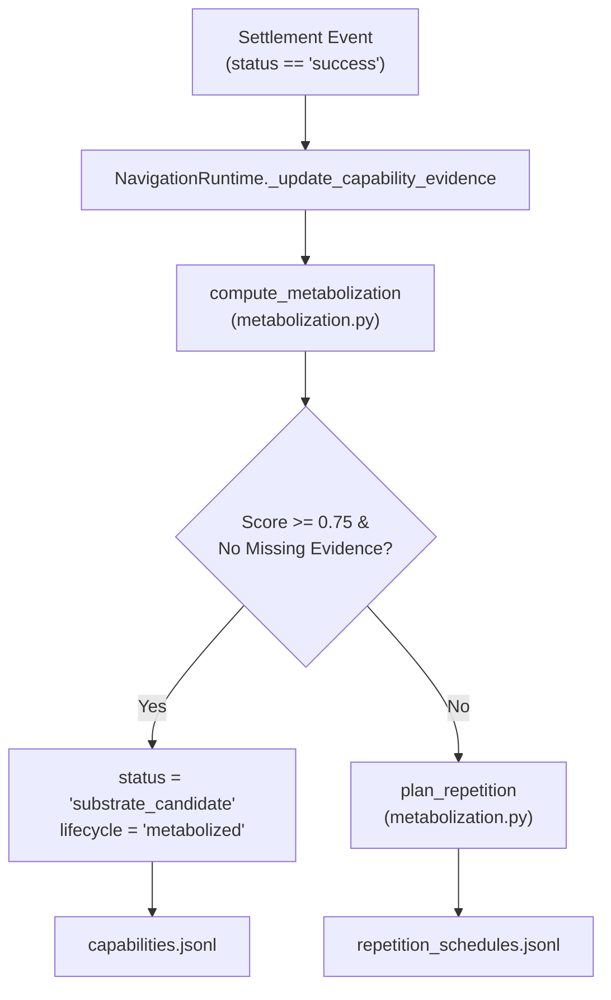
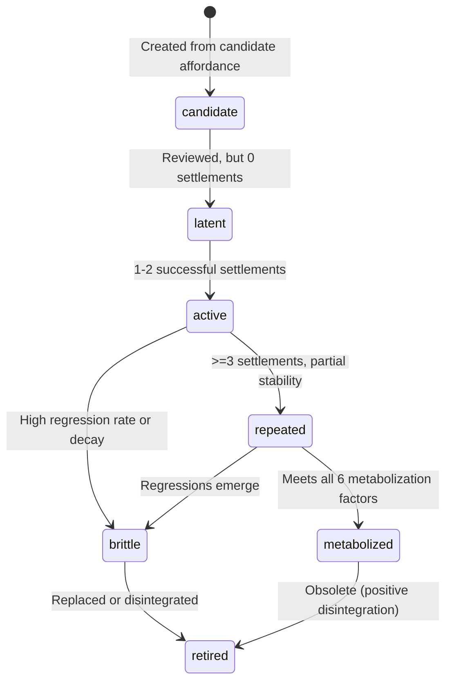

# Subsystem: Metabolization & Capability Lifecycle

The **Metabolization & Capability Lifecycle** subsystem models how repeated empirical settlements crystallize into durable, effortless **substrate**.

---

## 1. Purpose

The subsystem operationalizes the core doctrine that capability cannot be declared or scaffolded—it must be metabolized through repeated, varied settlement. It calculates objective metabolization scores, manages the 7-stage capability lifecycle, and schedules repetition under variation.

---

## 2. Responsibilities

- **6-Factor Metabolization Scoring**: Evaluates candidate capabilities against six strict empirical criteria.
- **Capability Lifecycle State Machine**: Advances capabilities through seven explicit developmental phases (`candidate`, `latent`, `active`, `repeated`, `metabolized`, `brittle`, `retired`).
- **Repetition Planning**: Automatically generates repetition schedules under declared environmental variation when an affordance settles successfully but has not yet reached substrate status.
- **Burden Decay Calculation**: Models the reduction of attention and maintenance burdens as settlement count increases.

---

## 3. Non-Responsibilities

- **Settlement Scoring**: Does not score the immediate consequence of an individual action; that is performed by `score_settlement`.
- **Durable Event Gating**: Delegates formal wire promotion verification to `developmental_memory.py`.

---

## 4. Position in the System



- **Callers**: `NavigationRuntime.record_settlement`, `NavigationRuntime.request_capability_promotion`, and the `metabolization` CLI command.
- **Callees**: Pure Python numerical evaluation.

---

## 5. The 6 Metabolization Factors

To achieve `substrate_candidate` status, a capability must satisfy all six factors without exception:

| Factor | Requirement | Metric / Formula | Rationale |
| :--- | :--- | :--- | :--- |
| **1. Settlement Count** | $\ge 3$ events | `len(settlement_events) >= 3` | A single success may be a fluke; three establishes repeatability. |
| **2. Reuse Frequency** | $\ge 3$ invocations | `reuse_frequency >= 3` | The capability must be actively demanded across different workflow tasks. |
| **3. Context Diversity** | $\ge 2$ contexts | `len(distinct_changed_keys) >= 2` | Verifies capability generalizes across different state contexts rather than overfitting one setup. |
| **4. Stability** | $\ge 0.8$ average | `mean(settlement_scores) >= 0.8` | High consequence quality with absence of regressions. |
| **5. Maintenance Burden** | $\le 0.3$ | $0.6 - (0.15 \times \text{count}) \le 0.3$ | Cost of keeping the capability working decays toward zero. |
| **6. Attention Burden** | $\le 0.3$ | $0.6 - (0.15 \times \text{count}) \le 0.3$ | Operator / agent oversight required to invoke it decays toward zero. |

$$\text{metabolization\_score} = \frac{\text{positive\_factors}}{6}$$

If `metabolization_score >= 0.75` and `missing_evidence` is empty, the recommendation is `substrate_candidate`; otherwise it remains `not_metabolized`.

---

## 6. The Capability Lifecycle State Machine



1. **`candidate`**: A proposed capability attached to a newly reviewed affordance.
2. **`latent`**: Recognized in the affordance inventory, but unexercised in practice.
3. **`active`**: Successfully settled at least once, but lacking sufficient repetition or context diversity.
4. **`repeated`**: Settled 3 or more times, but still carries high attention burden or context sensitivity.
5. **`metabolized`**: Proven substrate. Operates reliably across diverse contexts with minimal cognitive burden.
6. **`brittle`**: Previously active or repeated capability that begins exhibiting regressions or high maintenance costs.
7. **`retired`**: Obsolete capability dissolved through positive disintegration.

---

## 7. Repetition Planning under Variation

When an affordance settles successfully but has not yet metabolized into substrate, `plan_repetition` schedules a follow-up execution:
```json
{
  "affordance_id": "aff-auth-jwt",
  "status": "scheduled",
  "trigger": "successful_not_metabolized_settlement",
  "variation_coverage": 1,
  "next_condition": "changed_conditions",
  "recommended_delay": "next_affordable_variation",
  "critique_escalation": null
}
```

If the trajectory engine detects circular motion, `critique_escalation` is set to `"circular_motion"`, prompting the agent to introduce genuine environmental variation rather than re-running the exact same test case.

---

### Source Trail
- Subsystem File: `godspeed_nav/metabolization.py` (lines 1–54)
- Schema & Lifecycle: `godspeed_nav/schemas.py` (`infer_capability_lifecycle`, `Capability`)
- Runtime Integration: `godspeed_nav/runtime.py` (`_update_capability_evidence`, `_schedule_repetition`)
- Verification Suite: `tests/test_convergence_t09_developmental_memory.py`, `tests/test_convergence_t12_variation.py`
