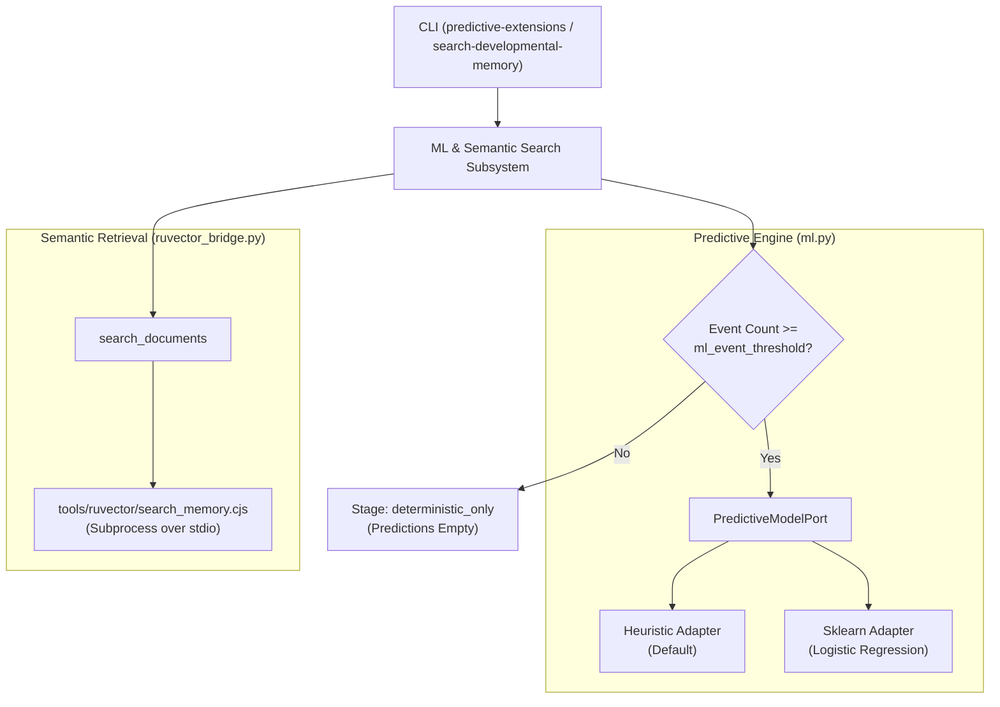

# Subsystem: ML & Semantic Search

The **ML & Semantic Search** subsystem provides advisory predictive capabilities and local-first vector similarity search across GodSpeed-Agent's developmental memory.

---

## 1. Purpose

The subsystem operationalizes two optional extensions while preserving local-first determinism:
1. **Advisory Predictive Extensions**: Uses historical settlement data to estimate candidate success probabilities without overriding deterministic gates.
2. **Semantic Vector Search**: Enables natural-language concept retrieval over structured developmental memory using a lightweight local Node.js RuVector sidecar.

---

## 2. Responsibilities

- **Predictive Model Port**: Defines the abstract interface (`PredictiveModelPort`) for all candidate prediction and simulation providers.
- **Threshold Gating**: Keeps machine learning extensions strictly dormant until the configured settlement event threshold (`ml_event_threshold: 200`) is satisfied.
- **Scikit-Learn Adapter**: Implements an inspectable logistic regression predictor for settlement success probabilities based on calibration data.
- **RuVector Bridge**: Manages subprocess communication with `tools/ruvector/search_memory.cjs` for local vector embeddings and cosine similarity search.

---

## 3. Non-Responsibilities

- **Authoritative Decision-Making**: Predictions are strictly advisory. A high predicted probability **cannot** bypass payment checks or hard governance gates.
- **Autonomous Training**: Does not run continuous ungrounded background model training.

---

## 4. Position in the System

---

## 5. The Predictive Lifecycle & Thresholds

To prevent premature reliance on predictive models ("imaginary muscles"), ML activation follows a staged progression defined in `HARNESS.md`:
- **Stage 1: `deterministic_only`** ($0 - 199$ settlements)
  Model is dormant. The runtime relies 100% on deterministic rules and economic burden calculations.
- **Stage 2: `advisory_predictions`** ($\ge 200$ settlements)
  The provider generates candidate success probabilities and predicted horizon deltas. Output is attached as advisory context in `horizon_reviews`.
- **Stage 3: `simulation_allowed`** ($\ge 1000$ settlements)
  Simulated dry-runs may be conducted for high-risk candidates to estimate potential payment variance before committing real resources.

---

## 6. The Sklearn Adapter

When `model_provider: sklearn` is enabled and the extra is installed (`uv sync --extra ml`), `SklearnPredictiveModelAdapter`:
1. Extracts calibration features from historical settlements using `build_calibration_frame`.
2. Requires at least 10 calibration rows with both positive and negative settlement classes.
3. Fits a standard scikit-learn `LogisticRegression` classifier over features:
   `["payment_predicted_total", "horizon_delta", "risk_estimate", "debt_estimate"]`.
4. Outputs calibrated probabilities in $[0.0, 1.0]$.

---

## 7. The RuVector Semantic Search Bridge

The RuVector bridge allows semantic search over structured memory summaries (e.g. searching for `"timeout recovery"`):
- Implementation: `godspeed_nav/ruvector_bridge.py`
- Protocol: JSON payload piped via `stdin` to `node tools/ruvector/search_memory.cjs`.
- Response: Ranked list of document matches with similarity scores.
- Safety: If Node.js is missing or `npm install` was not run in `tools/ruvector`, raises a clean `RuVectorBridgeError` with instructions rather than crashing the runtime.

---

### Source Trail
- Predictive Engine: `godspeed_nav/ml.py` (lines 1–393)
- Vector Bridge: `godspeed_nav/ruvector_bridge.py` (lines 1–63)
- Bridge Node Helper: `tools/ruvector/search_memory.cjs`
- Verification Suite: `tests/test_calibration_pipeline.py`, `tests/test_cli_hooks_mcp.py`
