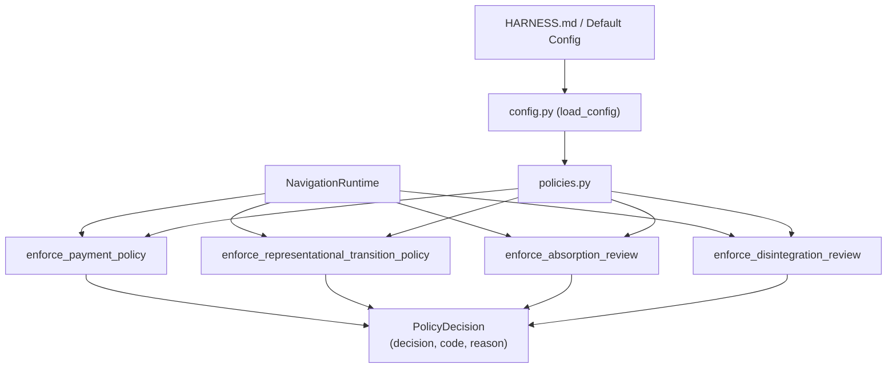

# Subsystem: Policy & Governance

The **Policy & Governance** subsystem enforces operational boundaries, safety rules, and human-in-the-loop review requirements across GodSpeed-Agent.

---

## 1. Purpose

The subsystem ensures that an agent does not exceed resource capacities, execute reckless representational jumps, absorb unvetted external code, or perform destructive system dissolution without explicit operator clearance.

---

## 2. Responsibilities

- **Configuration Loading**: Reads and resolves `HARNESS.md` policy files from the workspace root, applying sensible local defaults when configuration is absent.
- **Payment Policy Enforcement**: Evaluates payment burden against capacity norms, deciding whether to allow, warn, or hard-block unaffordable actions.
- **Representational Transition Gating**: Enforces adjacency rules and blocks un-metabolized diagonal opposition jumps across representational space.
- **Absorption Governance**: Enforces mandatory human-review gates before external capabilities are absorbed into a receiving project.
- **Positive Disintegration Governance**: Enforces mandatory human-review gates before high-risk structures are slated for destructive dissolution.

---

## 3. Non-Responsibilities

- **Payment Estimation**: Does not calculate cost norms; that is delegated to `estimate_payment`.
- **Affordance Ranking**: Does not sort candidates; that is delegated to `rank_affordances` and `rank_candidates_by_controller`.

---

## 4. Position in the System



---

## 5. Core Abstractions

- `PolicyDecision`: Immutable dataclass carrying:
  - `decision`: `"allow"`, `"warn"`, `"block"`, or `"requires_review"`.
  - `code`: Machine-readable categorization string.
  - `reason`: Human-readable explanation.
- `HarnessConfig`: Structured configuration dataclass parsed from the YAML frontmatter of `HARNESS.md`.

---

## 6. Policy Enforcement Mechanisms

### 1. Payment Policy (`enforce_payment_policy`)
When a candidate's `payment_burden` exceeds its `capacity_norm`:
- If `block_unaffordable_actions: true` in `HARNESS.md`, returns:
  `PolicyDecision("block", "unaffordable_action", "Payment exceeds capacity and blocking is enabled.")`
- If `warn_unaffordable_actions: true` (default), returns:
  `PolicyDecision("warn", "unaffordable_action", "Payment exceeds capacity; candidate should remain a possibility.")`
- If the action is affordable, returns:
  `PolicyDecision("allow", "affordable", "Payment is within configured capacity.")`

### 2. Representational Transition Policy (`enforce_representational_transition_policy`)
Inspects the output of `review_representational_transition`:
- If `status == "blocked"`, returns:
  `PolicyDecision("block", code, "Representational transition is not currently spendable.")`
- If `status in ("affordable", "metabolized")`, returns:
  `PolicyDecision("allow", code, "Representational transition is currently spendable.")`

### 3. Absorption Review Policy (`enforce_absorption_review`)
- If `require_human_review_for_absorption: true` (default), returns:
  `PolicyDecision("requires_review", "human_review_required", "Absorption requires human review before execution.")`
- Otherwise returns `PolicyDecision("allow", "human_review_not_required", ...)`

### 4. Disintegration Review Policy (`enforce_disintegration_review`)
- If `require_human_review_for_disintegration: true` (default) and structure risk is high, returns:
  `PolicyDecision("requires_review", "human_review_required", "Disintegration requires human review before execution.")`

---

## 7. Configuration Defaults (`HARNESS.md`)

```yaml
harness:
  mode: local
  primary_metric: horizon_expansion
  allow_outcome_language: true
  outcome_as_terminal: false
storage:
  root: .godspeed-harness
  format: jsonl
  retain_raw_events: true
  redact_secrets: true
computation:
  engine: python
  use_pandas: true
  use_numpy: true
  model_provider: heuristic
  ml_event_threshold: 200
  simulation_threshold: 1000
safety:
  block_unaffordable_actions: false
  warn_unaffordable_actions: true
  max_payment_burden: 100
  require_human_review_for_absorption: true
  require_human_review_for_disintegration: true
```

---

### Source Trail
- Policy Rules: `godspeed_nav/policies.py` (lines 1–88)
- Configuration Parser: `godspeed_nav/config.py` (lines 1–250)
- Policy Documentation: `docs/references/policy-reference.md`
- Verification Suite: `tests/test_policy_gates.py`, `tests/test_config.py`
