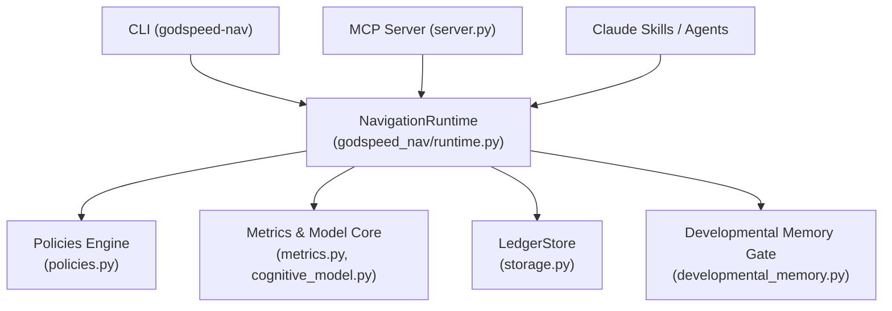

# Subsystem: Runtime Coordinator

The **Runtime Coordinator** is the central operational engine of GodSpeed-Agent. It coordinates the lifecycle of desired directions, executes horizon reviews, validates candidate affordances, records consequence-based settlements, updates polar trajectory, and projects developmental memory.

---

## 1. Purpose

The Runtime Coordinator provides the authoritative state machine for cybernetic navigation. It binds deterministic metrics, policy gates, and append-only ledgers into a cohesive loop that converts operator attractors into verifiable capability formation.

---

## 2. Responsibilities

- **Direction & Horizon Initialization**: Generates and tracks active desired directions and their corresponding visible horizons.
- **Representational Transitions**: Manages the observer's continuous coordinates and discrete phases, blocking un-metabolized opposition jumps.
- **Affordance Gating & Selection**: Evaluates candidate pathways against payment capacities and governance ceilings, partitioning candidates into affordances, possibilities, or potentials.
- **Settlement Recording**: Evaluates observable before/after consequence, enforcing the requirement that only persisted executable affordances may settle.
- **Trajectory Updating**: Translates settlement consequence and horizon delta into polar trajectory coordinates $(\theta, r)$ and flags circular motion.
- **Memory Projection**: Builds on-demand `DevelopmentalMemory` projections from durable events and incorporates memory into subsequent horizon reviews without violating hard gates.

---

## 3. Non-Responsibilities

- **Tool Execution & Process Running**: Does not execute bash commands, edit code, or launch test suites. Actions are executed by the hosting agent or harness (e.g. SWE_SEED).
- **Physical File IO**: Delegates all ledger append, deduplication, locking, and reading operations to `LedgerStore`.
- **Mathematical Kernel Calculations**: Delegates vector norm calculations, quadratic forms, and loss objectives to `godspeed_nav.metrics` and `godspeed_nav.cognitive_model`.

---

## 4. Position in the System

- **Callers**: Invocations enter via the CLI (`godspeed_nav/cli.py`), the MCP server (`mcp/cybernetic_nav_server/server.py`), or internal test drivers.
- **Callees**: Invokes `LedgerStore`, `enforce_payment_policy`, `enforce_representational_transition_policy`, `estimate_payment`, `rank_affordances`, `score_settlement`, `update_trajectory`, and `compute_metabolization`.

---

## 5. Core Abstractions

- `NavigationRuntime`: The primary state coordinator class initialized with a storage root and optional policy dictionary.
- `RepresentationalCoordinates`: 2D continuous coordinates `(scope, givenness)`.
- `DomainRuleError`: Specialized exception carrying a typed `code` (e.g., `settlement_requires_executable_affordance`) and descriptive message.

---

## 6. Internal Operation

### Horizon Review (`review_horizon`)
1. Iterates over submitted candidate dictionaries.
2. If `pathway` is absent, appends to `potentials.jsonl` with reason `missing_pathway`.
3. Computes `payment_burden` and checks `enforce_payment_policy`. If unaffordable or blocked, appends to `possibilities.jsonl`.
4. If affordable and approved, persists the candidate to `affordances.jsonl` and detailed steps to `affordance_paths.jsonl`.
5. Evaluates candidates through continuous spendability and advisory controller ranking (`rank_candidates_by_controller`).
6. Persists the complete review summary to `horizon_reviews.jsonl`.

### Settlement Recording (`record_settlement`)
1. **Executable Affordance Guard**: Calls `_require_executable_affordance(affordance_id)`. If the affordance is unknown or marked non-executable, raises `DomainRuleError("settlement_requires_executable_affordance")`.
2. **Consequence Evaluation**: Calls `score_settlement(before_state, after_state, desired_direction, payment_actual, evidence)`.
3. **Model Calibration Packaging**: Pairs predicted payment with actual payment and risk/debt estimates.
4. **Envelope Append**: Commits the settlement event envelope to `settlements.jsonl`.
5. **Spiral Trajectory Update**: Computes new $\theta$ and $r$. Persists to `trajectories.jsonl`.
6. **Capability Evidence Update**: Recalculates capability stability, diversity, and burden decay via `compute_metabolization`. Persists to `capabilities.jsonl`.
7. **Repetition Scheduling**: If capability is not yet a `substrate_candidate`, plans repetition under variation and writes to `repetition_schedules.jsonl`.

---

## 7. State Model

- **Owned Ledgers**: `desired_directions`, `horizons`, `representational_states`, `representational_transitions`, `affordance_paths`, `affordances`, `possibilities`, `potentials`, `settlements`, `trajectories`, `capabilities`, `repetition_schedules`, `critique_findings`.
- **Read State**: Queries historical settlements and trajectories to calculate capability stability and circular motion.

---

## 8. Failure Modes

| Observable Symptom | Likely Cause | Diagnostic Code | Recovery Path |
| :--- | :--- | :--- | :--- |
| `DomainRuleError: settlement_requires_executable_affordance` | Attempted to settle an affordance ID that was never reviewed, or that landed in `possibilities` or `potentials`. | `settlement_requires_executable_affordance` | Run `review-horizon` with sufficient capacity to produce an executable affordance before calling `record-settlement`. |
| Representational transition blocked | Attempted opposition jump (e.g. general to specific) without intermediate phase. | `blocked_opposition_jump` | Transition through an adjacent phase (`general` $\to$ `abstract` $\to$ `specific`). |
| Incomplete execution evidence | Ingested evidence missing `work_request_id`, `proof_result_id`, or outcomes. | `incomplete_execution_evidence` | Ensure evidence payload contains all 6 required fields. |

---

## 9. Extension Points

- **Custom Memory Ranking**: Subclasses or operators can customize `boost_factor` in `rank_candidates_with_memory` to adjust historical influence.
- **Alternative Attractor Types**: `start_direction` accepts polymorphic `kind` values (`problem`, `goal`, `vision`, `jtbd`, etc.).

---

### Source Trail
- Class Definition: `godspeed_nav/runtime.py` (lines 24–1007)
- Key Methods:
  - `start_direction`: `runtime.py:31-64`
  - `set_representational_state`: `runtime.py:65-89`
  - `review_horizon`: `runtime.py:91-227`
  - `rank_candidates_with_memory`: `runtime.py:307-356`
  - `record_settlement`: `runtime.py:542-633`
  - `ingest_execution_evidence`: `runtime.py:634-686`
  - `_require_executable_affordance`: `runtime.py:811-836`
- Verification Contract: `tests/test_runtime_workflow.py`
