# Subsystem: Storage & Ledgers

The **Storage & Ledgers** subsystem provides local-first, append-only, concurrent persistence for all cybernetic navigation events and developmental memory in GodSpeed-Agent.

---

## 1. Purpose

The subsystem guarantees that developmental history is durable, tamper-evident, and concurrently safe. It ensures that an agent's developmental memory survives process crashes, system reboots, and concurrent accesses without risking state corruption or data loss.

---

## 2. Responsibilities

- **Append-Only Event Logging**: Writes validated records to human-readable JSON Lines (`.jsonl`) files.
- **Concurrency Guarding**: Enforces operating-system-level file locking (`flock`) on all reads and writes.
- **Data Integrity & Checksumming**: Wraps formal event records in metadata envelopes containing SHA-256 digests.
- **Atomic Deduplication**: Checks for existing events and performs appends within a single atomic lock context.
- **Zero-Data-Loss Quarantine**: Isolates unparseable or checksum-corrupted lines into dedicated quarantine files without modifying valid records.
- **Secret Redaction**: Strips sensitive credentials (tokens, passwords, API keys) before writing to disk.
- **Index Management**: Maintains fast lookup sequence indexes for rapid event retrieval.

---

## 3. Non-Responsibilities

- **Semantic Domain Validation**: Does not validate whether an affordance is spendable or whether a settlement succeeded; that is owned by `NavigationRuntime` and `metrics`.
- **Relational Query Optimization**: Does not maintain SQL tables or complex relational joins in its baseline configuration.

---

## 4. Position in the System

```mermaid
flowchart TD
    subgraph Clients ["Callers"]
        NR["NavigationRuntime"]
        GATE["DevelopmentalMemoryGate"]
        CLI["CLI Commands"]
    end

    subgraph Storage ["LedgerStore (godspeed_nav/storage.py)"]
        LOCK["flock Guard"]
        REDACT["Secret Redactor"]
        ENV["Envelope & Checksum Engine"]
        QUAR["Quarantine Router"]
    end

    subgraph Disk [".godspeed-harness/ Directory"]
        L_DIR["ledgers/*.jsonl"]
        I_DIR["indexes/*.json"]
        Q_DIR["cache/quarantine/*.jsonl"]
        M_FILE["config/storage_manifest.json"]
    end

    Clients --> Storage
    Storage --> LOCK
    LOCK --> REDACT --> ENV --> L_DIR
    ENV --> I_DIR
    QUAR --> Q_DIR
    Storage --> M_FILE
```



- **Callers**: `NavigationRuntime`, `evidence_ingest`, `developmental_memory`, and CLI query commands.
- **Callees**: Local filesystem calls (`open`, `flock`, `fsync`, `mkdir`).

---

## 5. Core Abstractions

- `LedgerStore`: The primary storage manager class initialized with a directory root.
- `StorageError`: Typed exception raised on unsafe names or unrecoverable filesystem faults.
- `STORAGE_SCHEMA_VERSION`: Integer schema version stamp (currently `1`).
- `SECRET_KEYS`: Set of token substrings automatically scrubbed (`api_key`, `token`, `secret`, `password`, `authorization`).

---

## 6. Internal Operation

### Directory Topology
When `LedgerStore(root)` initializes, it verifies or creates four directories:
- `.godspeed-harness/ledgers/`: Active append-only JSONL files.
- `.godspeed-harness/indexes/`: JSON index files mapping record IDs to sequence numbers and timestamps.
- `.godspeed-harness/config/`: Contains `storage_manifest.json` carrying schema versions and initialization timestamps.
- `.godspeed-harness/cache/quarantine/`: Storage for corrupted or altered lines.

### Atomic Append under Lock (`append_event_if_absent`)
To prevent race conditions during concurrent event ingestion:
1. Opens the ledger file in `a+` mode.
2. Acquires an exclusive file lock: `fcntl.flock(handle.fileno(), fcntl.LOCK_EX)`.
3. Scans existing lines for `dedup_field == key_value`.
4. If found, sets `appended = False` and returns the existing envelope.
5. If absent, builds an envelope with `sequence = max_seq + 1` and computed SHA-256 checksum.
6. Writes the JSON line, flushes the stream, and calls `os.fsync(handle.fileno())`.
7. Releases lock and updates the corresponding index in `indexes/<ledger>.json`.

### Reading & Quarantine (`read`)
1. Reads all lines from the ledger file.
2. If a line fails JSON decoding or fails SHA-256 envelope checksum verification, it is flagged as corrupt.
3. If corrupt lines are found, they are atomically appended to:
   `.godspeed-harness/cache/quarantine/<ledger_name>.<iso_timestamp>.jsonl`
4. Only valid records are returned to the caller.

---

## 7. State & Physical Schema

### Event Envelope Format
```json
{
  "checksum": "d54f8...b7a",
  "ledger": "settlements",
  "record": {
    "affordance_id": "aff-001",
    "id": "set-001",
    "score": 1.0,
    "status": "success"
  },
  "schema_version": 1,
  "sequence": 1,
  "timestamp": "2026-06-03T18:00:00.000000+00:00"
}
```

Checksum Calculation:
$$\text{checksum} = \text{SHA256}(\text{JSON}(\text{record}) + \text{ledger} + \text{sequence} + \text{timestamp})$$

---

## 8. Failure Modes

| Failure Symptom | Underlying Cause | Automatic Mitigation | Operator Action |
| :--- | :--- | :--- | :--- |
| `StorageError: Unsafe ledger name` | Ledger name contains slashes, dots, or invalid characters. | Execution refused. | Ensure ledger names use only alphanumeric, `_`, and `-`. |
| Checksum mismatch during read | External process edited an event envelope directly on disk. | Corrupt line quarantined to `cache/quarantine/`. | Inspect quarantine ledger to audit unauthorized disk modifications. |
| Incomplete JSON line | Process crashed mid-write. | Corrupt line isolated to quarantine. | Valid prior records remain completely intact. |

---

## 9. Extension Points

- **Database Evolution**: Designed to allow migration to SQLite or DuckDB when record count exceeds `min_settlements_for_upgrade` (default: 1000). The migration contract is verified via `store.migration_status()`.
- **Vector Search Index**: Semantic retrieval over structured records delegates to the RuVector bridge via `store.search_developmental_memory(query)`.

---

### Source Trail
- Subsystem File: `godspeed_nav/storage.py`
- Core Class: `LedgerStore` (`storage.py:35-470`)
- Atomic Append: `LedgerStore.append_event_if_absent` (`storage.py:120-158`)
- Quarantine Logic: `LedgerStore._write_quarantine` (`storage.py:380-398`)
- Verification Suite: `tests/test_enterprise_storage.py`, `tests/test_domain_storage.py`
