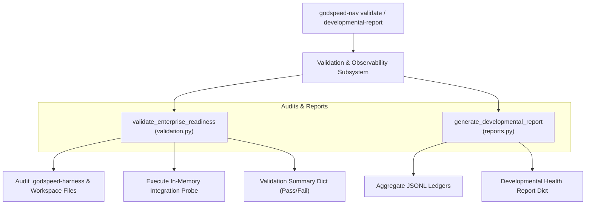

# Subsystem: Validation & Observability

The **Validation & Observability** subsystem provides enterprise verification, doctrine drift detection, and structured developmental reporting across GodSpeed-Agent.

---

## 1. Purpose

The subsystem enforces the principle of **self-critique** and **falsification**. It allows operators, continuous integration pipelines, and AI evaluators to audit whether an installation complies with enterprise invariants and whether active agent work is producing genuine horizon expansion.

---

## 2. Responsibilities

- **Enterprise Readiness Audit**: Executes 12 comprehensive checks validating plugin manifests, storage integrity, invariant gates, MCP responsiveness, and runtime lifecycles.
- **Doctrine Drift Detection**: Analyzes policy files and agent contracts to ensure that terms (like "simulation is not settlement") have not been weakened or bypassed.
- **Developmental Health Reporting**: Aggregates all local ledgers into a single diagnostic report (`settlement_quality`, `payment_debt`, `trajectory`, `circular_motion`, `identity_state`).

---

## 3. Non-Responsibilities

- **Unit Test Execution**: Does not replace pytest; it verifies runtime state, file shapes, and live integration boundaries.

---

## 4. Position in the System



---

## 5. The 12 Enterprise Readiness Audits

The `validate` command executes twelve automated checks:

| Check Name | Target Surface | Pass Criterion |
| :--- | :--- | :--- |
| `plugin_structure` | Filesystem | All 6 required plugin files exist (`plugin.json`, `HARNESS.md`, `.mcp.json`, etc.). |
| `config` | `HARNESS.md` | Primary metric is `horizon_expansion` and `outcome_as_terminal: false`. |
| `predictive_extensions` | `ml.py` | Configured provider matches configuration; thresholds are respected. |
| `storage` | `storage.py` | Storage manifest exists and migration status is `current`. |
| `developmental_memory` | `storage.py` | Lineage queries (`paid_paths`, `failed_settlements`, `substrate`) return valid sets. |
| `doctrine_drift` | Documentation / Contracts | Explicitly verifies that policy reference and evaluator docs reject simulation as capability. |
| `executable_affordance_rule` | `runtime.py` | Confirms that settling an unreviewed affordance raises `settlement_requires_executable_affordance`. |
| `provisional_evidence_boundary`| `evidence_ingest.py` | Confirms that `EvidenceRecorded` without a persisted affordance is rejected. |
| `storage_invariants` | `storage.py` | Verifies atomic append-if-absent, flock locking, and secret redaction. |
| `mcp_server` | `mcp/server.py` | Confirms all 21 MCP tool definitions are registered and syntactically valid. |
| `runtime_workflow` | `runtime.py` | Executes a complete in-memory cycle (`start` $\to$ `horizon` $\to$ `settle` $\to$ `repetition`). |
| `developmental_report` | `reports.py` | Confirms report generation runs clean across all active ledgers. |

---

## 6. Developmental Health Report Structure

Generated via `godspeed-nav developmental-report`:
```json
{
  "active_directions": 1,
  "identity_state": {
    "settlement_count": 3,
    "unique_capabilities": 1
  },
  "metabolization": {
    "candidate_count": 1,
    "candidate_ids": ["aff-cli-loop"]
  },
  "payment_debt": {
    "dominant_cost": "time",
    "payment_count": 3,
    "total_burden": 5.2
  },
  "settlement_quality": {
    "failed": 0,
    "partial": 0,
    "success": 3
  },
  "trajectory": {
    "circular_motion": false,
    "latest_radius": 2.4,
    "latest_theta": 1.2,
    "radius_growth": 1.4
  }
}
```

---

### Source Trail
- Validation Implementation: `godspeed_nav/validation.py` (lines 1–472)
- Report Implementation: `godspeed_nav/reports.py` (lines 1–160)
- Detailed Interpretation Guide: `docs/references/report-interpretation.md`
- Verification Suite: `tests/test_validation.py`, `tests/test_reports.py`
