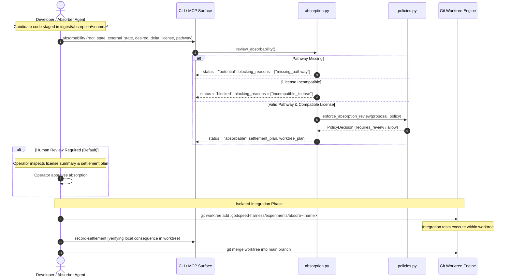

# Workflow: External Capability Absorption

This document traces the complete workflow for evaluating, staging, and absorbing external code, skills, or libraries into a receiving project using GodSpeed-Agent.

---

## 1. Summary

The Absorption Lifecycle ensures that external software is never prematurely integrated into a target project. Material staged in `ingest/absorption/<name>/` remains strictly classified as `potential` until an actionable local pathway exists. It becomes `absorbable` only when license compatibility, payment burden, policy gates, and an empirical settlement plan align. Execution is isolated within temporary git worktrees to protect main branches from unvetted code.

---

## 2. Sequence Diagram

---

## 3. Detailed Execution Path

### Phase 1: Candidate Staging
1. External code, agents, or tools are placed in the receiving project's ingest root:
   `ingest/absorption/<candidate-name>/`
2. An absorption proposal document is prepared with:
   - `candidate-notes.md`: Summary of external functionality.
   - `license-summary.json`: License classification (`MIT`, `Apache-2.0`, `GPL`, etc.).
   - `settlement-plan.md`: Empirical verification test specification.

### Phase 2: Absorbability Audit (`review_absorbability`)
- Command: `godspeed-nav absorbability --root-state '{...}' --external-state '{...}' --desired '{...}' --capability-delta '["..."]' --license '{"compatible": true}' --pathway "call local adapter"`
- **Step 2A: Pathway Verification**: If `--pathway` is omitted or blank, `status` is set to `"potential"` with blocking reason `missing_pathway`.
- **Step 2B: License Audit**: If `license.compatible == false`, `status` is set to `"blocked"`.
- **Step 2C: Governance Gate**: Evaluates `enforce_absorption_review`. If `require_human_review_for_absorption: true`, marks `required_human_review: true`.
- **Step 2D: Settlement & Worktree Planning**:
  Generates a 3-step settlement plan and defines an isolated git worktree branch:
  `branch: "absorb/external-capability"`

### Phase 3: Worktree Isolation & Consequence Settlement
1. Developer creates a git worktree to isolate candidate execution:
   `git worktree add -b absorb/<candidate> .godspeed-harness/experiments/<candidate>`
2. Adapts code to the local project interface within the worktree.
3. Runs verification tests.
4. If tests pass, invokes `godspeed-nav record-settlement` to commit the consequence to developmental memory.
5. Merges worktree into the primary project branch.

---

## 4. Failure Modes & Mitigations

| Failure Symptom | Cause | Mitigation |
| :--- | :--- | :--- |
| Candidate stuck in `potential` | No concrete local integration pathway was specified. | Formulate an adapter pathway before attempting absorption. |
| Candidate `blocked` | License incompatible with receiving project (e.g. AGPL in MIT project). | Replace external candidate or obtain commercial license. |
| Premature merge without proof | Developer attempts direct merge into main branch. | Enforce git worktree isolation and require passing settlement evidence. |

---

### Source Trail
- Subsystem File: `godspeed_nav/absorption.py` (lines 1–61)
- Policy Enforcement: `godspeed_nav/policies.py` (`enforce_absorption_review`)
- Operational Runbook: `docs/runbooks/absorption-ingest.md`
- Verification Suite: `tests/test_policy_gates.py`
