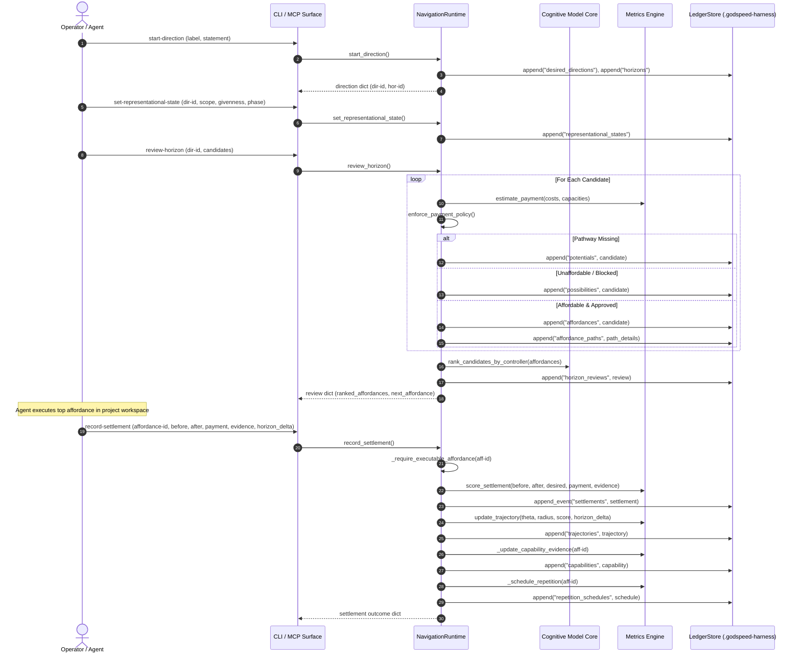

# Workflow: The Core Developmental Cycle

This document traces the primary execution workflow of GodSpeed-Agent from initial direction conception to settled capability metabolization.

---

## 1. Summary

The Core Developmental Cycle is the fundamental engine of capability formation in GodSpeed-Agent. An agent or operator identifies an attractor direction, establishes its representational coordinates, reviews candidate affordance pathways against payment capacity and governance gates, spends the top-ranked affordance, records empirical before/after settlement consequences, updates spiral trajectory, and plans repetition under variation until the capability crystallizes into permanent substrate.

---

## 2. Sequence Diagram

---

## 3. Detailed Execution Steps

### Step 1: Direction Initiation
- **Invocation**: `godspeed-nav start-direction --label "..." --statement "..."`
- **Method**: `NavigationRuntime.start_direction` (`runtime.py:31`)
- **State Written**:
  - `desired_directions.jsonl`: ID `dir-<uuid>`, status `"active"`, linked `horizon_id`.
  - `horizons.jsonl`: ID `hor-<uuid>`, observer `"local-operator"`, initial radius $1.0$.

### Step 2: Representational Anchoring
- **Invocation**: `godspeed-nav set-representational-state --direction-id <id> --scope-position 0.2 --mode-of-givenness-position 0.2 --phase "general" ...`
- **Method**: `NavigationRuntime.set_representational_state` (`runtime.py:65`)
- **State Written**:
  - `representational_states.jsonl`: Continuous coordinates $(0.2, 0.2)$, phase `"general"`.

### Step 3: Horizon Review & Gating
- **Invocation**: `godspeed-nav review-horizon --direction-id <id> --candidates '[...]'`
- **Method**: `NavigationRuntime.review_horizon` (`runtime.py:91`)
- **Logic**:
  1. Partitions candidates missing pathways into `potentials.jsonl`.
  2. Computes payment burden norm via `estimate_payment` (`metrics.py:102`).
  3. Evaluates `enforce_payment_policy` (`policies.py:17`).
  4. Partitions candidates exceeding capacity into `possibilities.jsonl`.
  5. Commits viable candidates to `affordances.jsonl` and `affordance_paths.jsonl`.
  6. Ranks approved affordances using the cybernetic controller loss function (`cognitive_model.py:288`).
  7. Persists review summary to `horizon_reviews.jsonl`.

### Step 4: Empirical Action & Observation
- The agent or operator executes the physical actions (e.g. running tests, generating code, applying migrations).
- GSA does not intervene in execution; it awaits observable before/after state diffs and verification logs.

### Step 5: Settlement Recording
- **Invocation**: `godspeed-nav record-settlement --affordance-id <id> --before '{...}' --after '{...}' --payment '{...}' --evidence '["..."]' --horizon-delta 1.0`
- **Method**: `NavigationRuntime.record_settlement` (`runtime.py:542`)
- **Logic**:
  1. `_require_executable_affordance`: Confirms that `affordance-id` is in `affordances.jsonl` with `current_status == 'affordance'`.
  2. `score_settlement`: Strips intent strings (`"intent:..."`), calculates net progress versus desired state, checks for regressions (`metrics.py:122`).
  3. Writes event envelope to `settlements.jsonl`.
  4. Updates spiral trajectory in `trajectories.jsonl`:
     $$\Delta\theta = \max(0.1, |\Delta h| \times 0.1), \quad \Delta r = \max(0, \text{score} - 0.5) \times \max(0, \Delta h)$$
  5. Updates capability evidence in `capabilities.jsonl` using `compute_metabolization`.
  6. Emits repetition plan in `repetition_schedules.jsonl` if not yet a substrate candidate.

---

## 4. Failure & Alternate Branches

| Point of Failure | Cause | Outcome |
| :--- | :--- | :--- |
| Horizon Review | Candidate missing `pathway` string. | Diverted to `potentials.jsonl`; excluded from affordance list. |
| Horizon Review | Candidate payment burden exceeds capacity norm. | Diverted to `possibilities.jsonl`; excluded from affordance list. |
| Horizon Review | Candidate risk exceeds context ceiling. | Blocked by hard gate in `evaluate_candidate_model`. |
| Settlement | Candidate affordance was never reviewed or was diverted to `possibilities`. | Execution aborted with `DomainRuleError("settlement_requires_executable_affordance")`. |
| Settlement | Evidence consists solely of `"intent:..."` strings. | Scored as `0.0` with status `"failed"` and `missing_evidence: ["observable_consequence"]`. |
| Settlement | Key regressions outweigh improvements. | Score capped at `0.69`; status set to `"partial"`. |

---

### Source Trail
- Coordinator: `godspeed_nav/runtime.py`
- Metrics: `godspeed_nav/metrics.py`
- Cognitive Model: `godspeed_nav/cognitive_model.py`
- Verification Suite: `tests/test_runtime_workflow.py`
