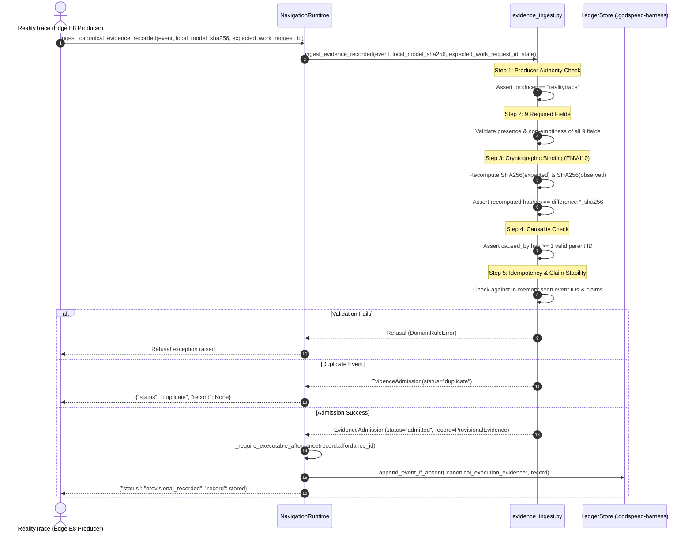

# Workflow: Evidence Ingestion Trace

This document traces the complete execution path when external execution proof (`EvidenceRecorded`) enters GodSpeed-Agent across the Edge E8 boundary.

---

## 1. Summary

The Evidence Ingestion Trace models how external test and tool results (emitted by test harnesses such as SWE_SEED and stamped by RealityTrace) are securely admitted into GodSpeed-Agent. The subsystem validates producer identity, verifies cryptographic diff bindings, checks causality chains, asserts that an executable affordance exists, and writes the record into `canonical_execution_evidence.jsonl` as **provisional data**. Crucially, this trace never updates trajectories, capability records, or settlements.

---

## 2. Sequence Diagram

---

## 3. Detailed Execution Path

### Step 1: Entry Point
- Invocations enter via `NavigationRuntime.ingest_canonical_evidence_recorded` (`runtime.py:688`).
- Arguments:
  - `event`: Raw dict representation of the canonical `EvidenceRecorded` envelope.
  - `local_model_sha256`: The structural SHA-256 digest of the active manifest.
  - `expected_work_request_id`: Active cycle identifier.
  - `known_parent_ids`: Optional out-of-band list of valid upstream evidence IDs.

### Step 2: Pure Admission Gating
- Invokes `ingest_evidence_recorded` in `godspeed_nav/evidence_ingest.py`:
  1. **Producer Check**: `event.get("provenance", {}).get("origin") == "realitytrace"`. Rejects any other author.
  2. **Namespace & Version**: `event["schema_version"] == "v1"` and `event["namespace"] == "agentic_capability_loop"`.
  3. **Hash Verification**: `domain_model_ref` must match `local_model_sha256`. Rejects pseudo-hash fallback constants.
  4. **Cryptographic Binding**: Recomputes SHA-256 of `expected_outcome` and `observed_outcome`. If they differ from `difference.expected_sha256` or `difference.observed_sha256`, raises `DomainRuleError("cryptographic_difference_mismatch")`.
  5. **Claim Stability**: Verifies tuple `(work_request_id, proof_result_ref)` has not been submitted previously with conflicting data.

### Step 3: Affordance Linkage Guard
- Before committing to disk, `NavigationRuntime` calls `_require_executable_affordance(payload["affordance_id"])`.
- If the referenced affordance ID is unknown, or resides in `potentials` or `possibilities`, execution fails closed.

### Step 4: Atomic Flocked Append
- Invokes `LedgerStore.append_event_if_absent("canonical_execution_evidence", record, dedup_field="evidence_event_id")`.
- Under exclusive `fcntl.flock`, checks for existing record and writes checksummed envelope.
- Returns `{"status": "provisional_recorded", "record": ...}`.

---

## 4. Invariant I8: Strict Provisional Status

The admitted record has status `"provisional"`:
- It is written **only** to `canonical_execution_evidence.jsonl`.
- It does **not** update `settlements.jsonl`.
- It does **not** advance capability lifecycle in `capabilities.jsonl`.
- It does **not** modify radial growth in `trajectories.jsonl`.
- Promotion to settlement requires an explicit operator call to `record-settlement` evaluating before/after state consequence.

---

### Source Trail
- Subsystem File: `godspeed_nav/evidence_ingest.py` (lines 1–512)
- Runtime Gate: `godspeed_nav/runtime.py` (lines 688–744)
- Test Verification: `tests/test_convergence_t08_evidence_recorded.py`
