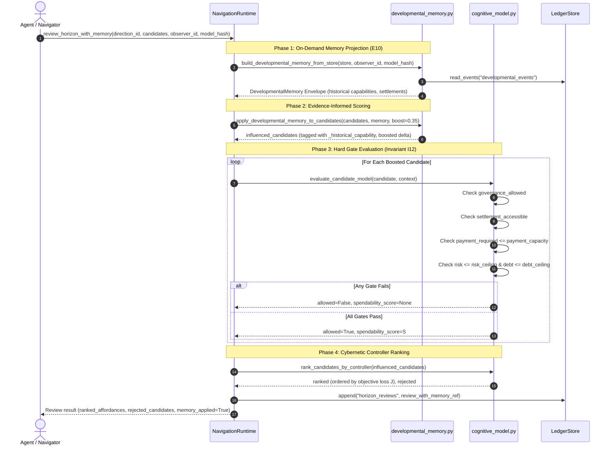

# Workflow: Memory-Informed Navigation

This document traces how historical developmental memory is retrieved and incorporated into new navigation cycles across the Edge E10 seam without compromising hard governance and safety gates.

---

## 1. Summary

The Memory-Informed Navigation workflow implements the **Gate-Evaluation-After-Memory** pattern (Edge E10 / Invariant I12). When an agent evaluates candidate affordances, durable developmental memory is projected on-demand from historical settlements. Candidates that echo historical capabilities receive a modest search burden discount (a boost to expected horizon delta). Crucially, every candidate is then evaluated through hard governance, payment capacity, and risk/debt ceilings. Historical capability evidence can reduce cognitive burden, but it can **never** flip a blocked gate to allowed.

---

## 2. Sequence Diagram

---

## 3. Detailed Execution Steps

### Phase 1: On-Demand Memory Projection
- Invocations enter via `NavigationRuntime.review_horizon_with_memory` (`runtime.py:357`).
- If `developmental_memory` is not provided, the runtime calls `get_developmental_memory(observer_or_system_id, domain_model_hash)`.
- `build_developmental_memory_from_store` scans `developmental_events.jsonl` under flock, re-validating admissions and extracting earned capabilities.

### Phase 2: Memory-Informed Candidate Boosting
- Invokes `apply_developmental_memory_to_candidates` (`developmental_memory.py:610`).
- For each candidate whose `id` matches a historically verified capability:
  - Tags the candidate with `_historical_capability: True` and `_memory_influenced: True`.
  - Applies a boost factor ($\approx 0.35$) to `expected_horizon_delta` and `direction_score`.
  - Reduces estimated search burden.

### Phase 3: The Hard Gate Firewall (Invariant I12)
Every candidate is evaluated through `evaluate_candidate_model` (`cognitive_model.py:219`):
1. `governance_allowed`: Must be True.
2. `settlement_accessible`: Must be True.
3. `payment_capacity`: Every required currency must fall within current capacity.
4. `risk_ceiling` & `debt_ceiling`: Must not exceed context-specific thresholds.

**Non-Negotiable Invariant**: Even if a candidate has 100 historical settlements, if current payment exceeds capacity or risk exceeds the ceiling, it is **blocked immediately**.

### Phase 4: Controller Loss Minimization
Approved candidates are sorted by the cybernetic controller objective:
$$J = \text{error\_cost} + \lambda \cdot \text{burden} + \mu \cdot \text{risk} + \nu \cdot \text{debt} - \eta \cdot \text{horizon\_gain} - \kappa \cdot \text{direction\_score}$$
The review is committed to `horizon_reviews.jsonl` with an explicit `developmental_memory_ref` provenance pointer.

---

## 4. Why This Architecture Matters

In naive agent architectures:
- Memory is injected as prompt text, allowing the agent to hallucinate that because it succeeded yesterday, it has unlimited resources today.
- Historical success overrides current resource budgets.

In GodSpeed-Agent:
- Memory is treated strictly as **statistical evidence**.
- Historical success reduces search uncertainty but cannot purchase resources the agent does not possess.

---

### Source Trail
- Horizon Review with Memory: `godspeed_nav/runtime.py:357-425`
- Candidate Ranking with Memory: `godspeed_nav/runtime.py:307-356`
- Memory Projection: `godspeed_nav/developmental_memory.py:450-520`
- Candidate Boost: `godspeed_nav/developmental_memory.py:610-675`
- Verification Suite: `tests/test_convergence_t10_developmental_memory_feedback.py`
