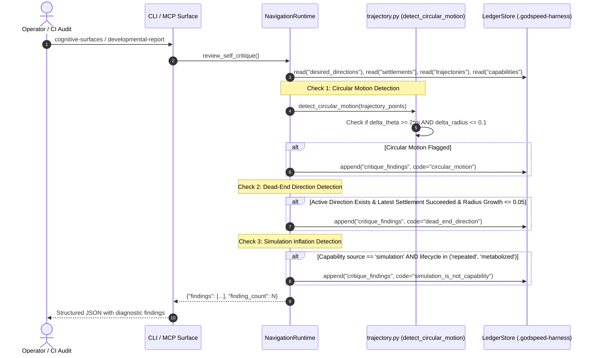

# Workflow: Self-Critique & Stagnation Detection

This document traces how GodSpeed-Agent analyzes its own trajectory and developmental history to detect stagnation, circular motion, dead-end directions, and simulated capability inflation.

---

## 1. Summary

The Self-Critique & Stagnation Detection workflow operationalizes the cybernetic principle of **runtime-owned falsification**. During developmental reporting or periodic review, the runtime evaluates recent trajectory points $(\theta, r)$, active directions, and capability evidence sources. If work produces rotation without radial growth, if settlement produces no horizon expansion, or if simulation is claimed as capability, the system writes formal critique findings to `critique_findings.jsonl` and prompts corrective action.

---

## 2. Sequence Diagram



---

## 3. The Three Falsification Audits

### 1. Circular Motion (`circular_motion`)
- **Mechanism**: `detect_circular_motion` in `godspeed_nav/trajectory.py`.
- **Trigger**:
  $$\text{rotation} = |\theta_{\text{latest}} - \theta_{\text{initial}}| \ge 2\pi \quad \text{AND} \quad \text{radius\_growth} = (r_{\text{latest}} - r_{\text{initial}}) \le 0.1$$
- **Meaning**: The agent has performed a full $360^\circ$ circle of activity, expending time and compute, without achieving meaningful radial expansion.
- **Finding Emitted**:
  ```json
  {
    "code": "circular_motion",
    "reason": "Rotation is outpacing radial growth.",
    "created_at": "2026-06-03T18:00:00.000000+00:00"
  }
  ```

### 2. Dead-End Direction (`dead_end_direction`)
- **Trigger**: An active desired direction exists and the latest settlement was marked `"success"`, but the resulting trajectory radius remains $\le 1.05$.
- **Meaning**: The agent successfully achieved its declared micro-goal, but the outcome was trivial and failed to expand the reachable horizon.
- **Finding Emitted**:
  ```json
  {
    "code": "dead_end_direction",
    "reason": "Settlement succeeded without meaningful horizon expansion."
  }
  ```

### 3. Simulation Inflation (`simulation_is_not_capability`)
- **Trigger**: A record in `capabilities.jsonl` has `evidence_source == "simulation"` while claiming `lifecycle_state` of `"repeated"` or `"metabolized"`.
- **Meaning**: The agent attempted to treat dry-run simulation output as empirical evidence of real-world capability.
- **Finding Emitted**:
  ```json
  {
    "code": "simulation_is_not_capability",
    "reason": "Simulation output cannot be metabolized capability evidence."
  }
  ```

---

## 4. Operator Recovery Paths

When critique findings are emitted, the operator or supervising agent should execute the following corrective workflows:
- **For `circular_motion`**: Introduce genuine environmental variation. Cease re-running the same unit test or refactoring the same module; schedule repetition under new constraints via `repetition-plan`.
- **For `dead_end_direction`**: Terminate or archive the attractor direction (`dir.status = "dead"`). Formulate a bolder desired direction that unlocks downstream affordances.
- **For `simulation_is_not_capability`**: Re-run the candidate within a live execution environment (e.g. executing against live test databases or external services) and record real consequence.

---

### Source Trail
- Self-Critique Engine: `godspeed_nav/runtime.py` (`review_self_critique`, lines 471–541)
- Trajectory Detector: `godspeed_nav/trajectory.py` (`detect_circular_motion`, lines 33–48)
- Reporting Integration: `godspeed_nav/reports.py` (lines 85–120)
- Verification Suite: `tests/test_runtime_workflow.py`, `tests/test_reports.py`
